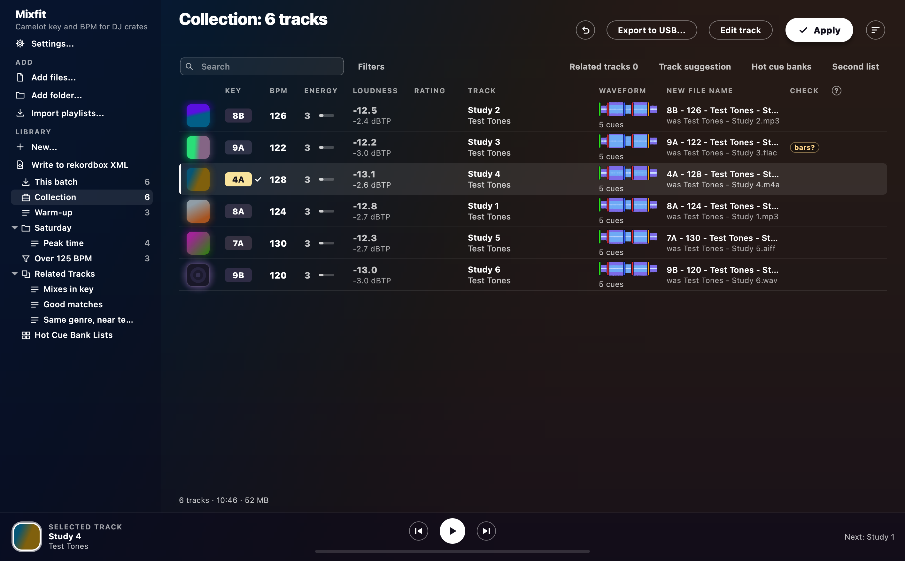
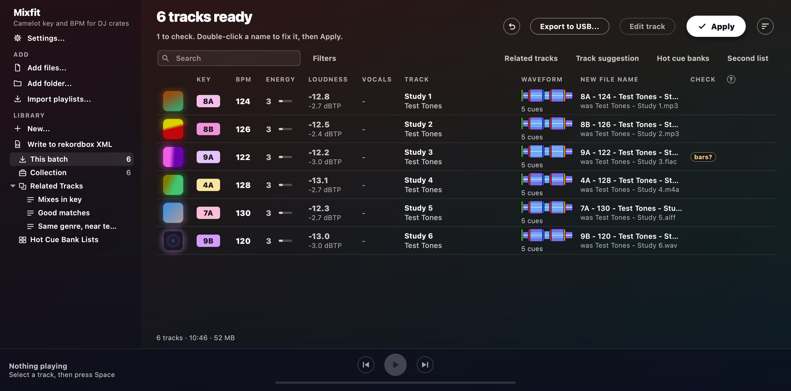
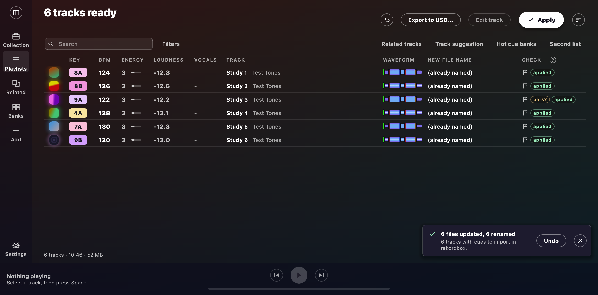
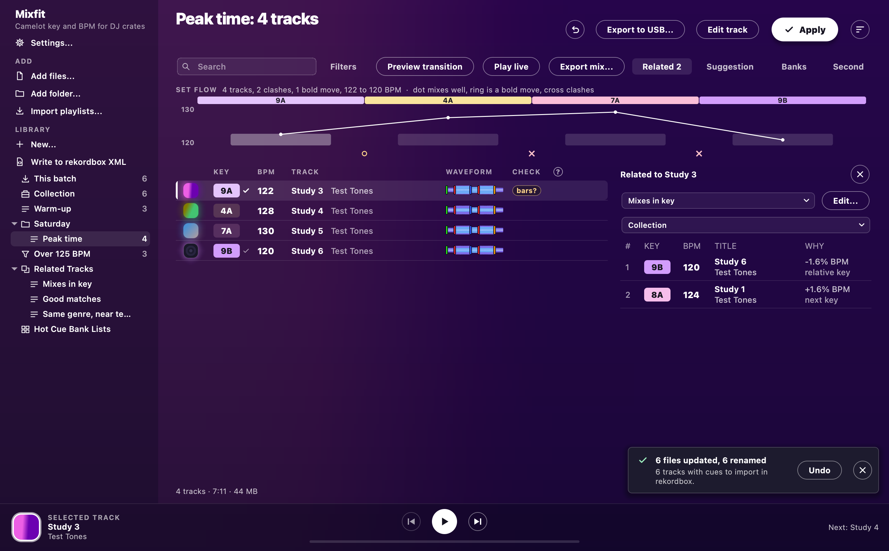
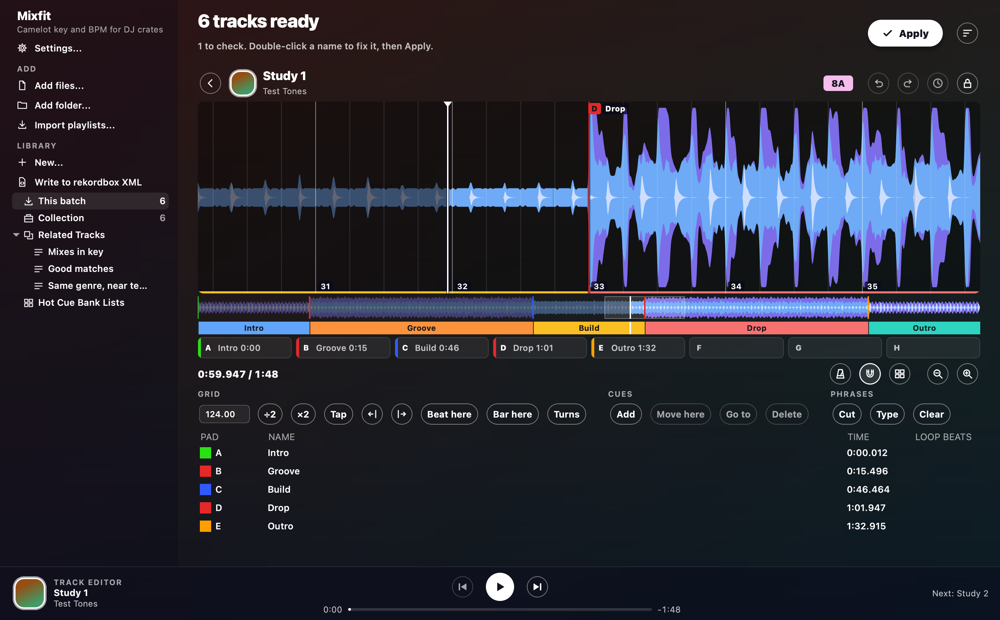
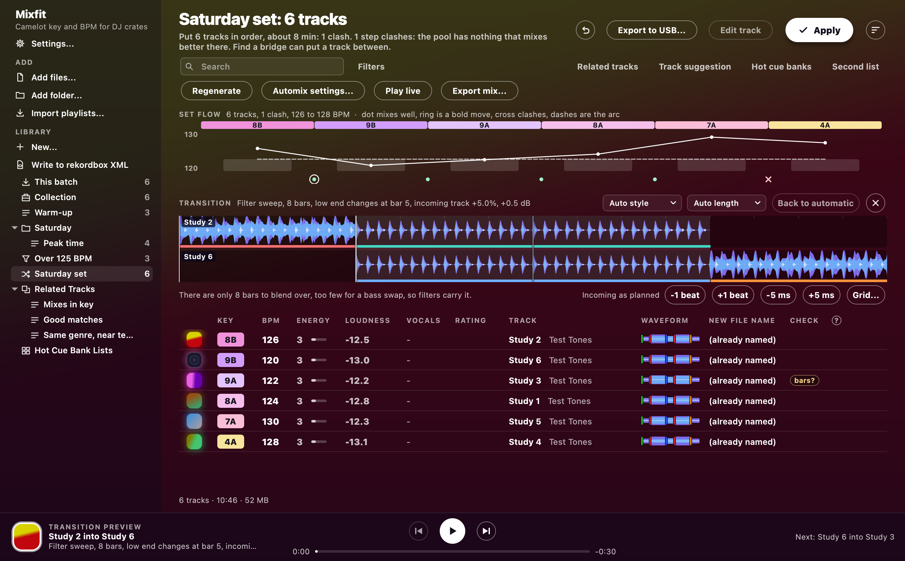
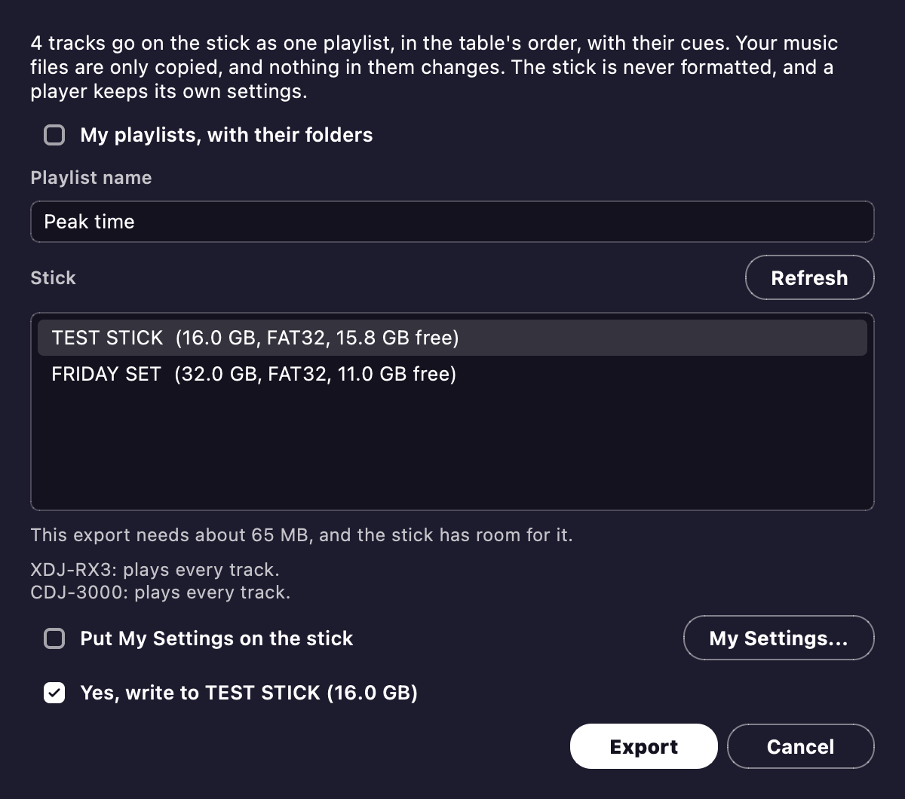

# Mixfit

**Key, BPM, beat grids, cues and tidy names for your DJ tracks, on macOS and Windows.**
Drop a folder of music on the window, check what it found, and press Apply.

 

## What it does

<table>
<tr>
<td width="50%" valign="top">

**[Key and BPM analysis](manual/analysis.md)** 
Camelot or musical key, BPM, beat grid, energy, loudness, vocals and phrases, with a check on anything worth a listen.

</td>
<td width="50%" valign="top">

**[Tags and names](manual/tags.md)** 
Apply writes the key and BPM where rekordbox, Serato and Traktor read them, renames to `8A - 124 - Artist - Title.mp3`, and Undo takes it back.

</td>
</tr>
<tr>
<td valign="top">

**[Library and playlists](manual/library.md)** 
Playlists, folders, matchlists, related tracks and track suggestions, imported from rekordbox or Apple Music if you like.

</td>
<td valign="top">

**[Track editor](manual/editor.md)** 
Hear a track and set its beat grid, hot cues, memory cues and phrases by ear.

</td>
</tr>
<tr>
<td valign="top">

**[Automix](manual/automix.md)** 
Just listen to your library and see if the robots do anything sick, previews each transition, plays it live with each track's vocals, drums and bass in your hands, or renders it to one file.

</td>
<td valign="top">

**[USB sticks](manual/usb.md) and [sync](manual/sync.md)** 
Writes a stick CDJ and XDJ players read, with no rekordbox, and sends playlists to rekordbox, Serato, Traktor or Engine DJ.

</td>
</tr>
</table>

Analysis is scored against known answers (generated tracks, and marks a person checked by ear), not against rekordbox, and where a result is unsure the app says so (`key?`, `bpm?`, `bars?`) instead of guessing.
Your music stays on your computer: only artist, title and album leave it, for cover art lookups you can turn off.

## Install

Download the app from the [latest release](https://github.com/plep7/dj-key-tool/releases/latest) and unzip it.

| Computer | Download | Needs |
| --- | --- | --- |
| Mac | [`Pat-In-Key-mac.zip`](https://github.com/plep7/dj-key-tool/releases/latest/download/Pat-In-Key-mac.zip) | Apple silicon, macOS 14.4 or later |
| Windows | [`Pat-In-Key-win64.zip`](https://github.com/plep7/dj-key-tool/releases/latest/download/Pat-In-Key-win64.zip) | 64-bit Windows 10 or 11 |

Everything it uses is bundled.
It is not code-signed, so Windows SmartScreen asks once (*More info*, then *Run anyway*).
On a Mac, drag it into Applications first (or it can't update itself), open it once, then choose **Open Anyway** in System Settings > Privacy & Security.
After that it [updates itself](manual/updates.md).

## Quick start

1. Drop a folder of tracks on the window, or use **Add folder...**.
2. Wait for the analysis, then look at the Check column: hover over a check to see why a track is worth a listen.
3. Fix any name by double-clicking it, and pick what Apply does in [Settings](manual/settings.md).
4. Press **Apply** to write tags and names, and **Undo last Apply** if you change your mind.
5. Take the tracks out: [rekordbox cues](manual/editor.md#cue-points), a [USB stick](manual/usb.md) or [another app](manual/sync.md).

> Renaming tracks already in a DJ app's collection makes them show as missing there, so read [Renaming and your DJ library](manual/tags.md#renaming-and-your-dj-library) first.

## More

- [The manual](manual/README.md): every feature, one page per area.
- [The command line](manual/command-line.md): the same work from a script.
- [USB stick test kit](USB-TEST-KIT.md): test a stick on a real player, with a page to send a friend.

## Licence

AGPL-3.0, as Essentia requires.
The app bundles other open-source parts under their own licences, listed in [the manual](manual/README.md#licence).
