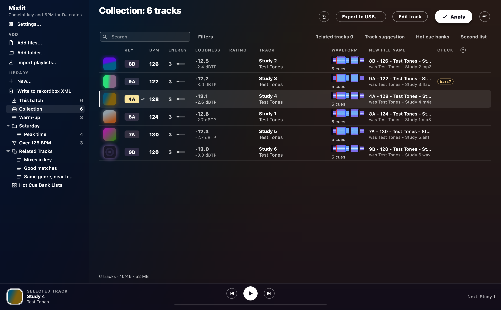

# Mixfit manual

Mixfit analyses your tracks for key, BPM, beat grid, energy, loudness, vocals and phrases.
It tags and renames your tracks, and it keeps them in a library with playlists.
It also gets your tracks onto players and into other DJ apps.
Each page below covers one part of the app.
Most pages start with a picture, so you know where you are.

| Page | What's in it |
| --- | --- |
| [The window](window.md) | The track table, search, filters, sorting, the player bar, keys and the command palette |
| [Analysis](analysis.md) | How key, BPM, grid, energy, loudness, vocals, phrases and waveforms get measured, the checks, and how far you can trust each one |
| [Tags, names and Apply](tags.md) | What Apply writes, file name and title formats, keys in rekordbox, cover art, ReplayGain and Undo |
| [Library and playlists](library.md) | The library, Activity, playlists, matchlists, Track info, Smart Fixes, missing files, duplicates, watch folders, backups, imports, related tracks, hot cue banks and track suggestion |
| [Track editor and cues](editor.md) | Setting a grid, cues and phrases by ear, the cues Apply makes for rekordbox, learning your own cues, cue history and Hot Cue Auto Load |
| [Automix](automix.md) | Building a set, the set flow, previewing transitions, rendering a mix and playing live |
| [USB and players](usb.md) | Writing a stick for CDJ and XDJ players, and My Settings |
| [Sync](sync.md) | Your playlists in rekordbox's XML, and syncing to Serato, Traktor and Engine DJ |
| [Settings](settings.md) | Every setting, the background, the audio output and where your data lives |
| [Updates](updates.md) | How the app keeps itself up to date |
| [The command line](command-line.md) | The same work, from a script |

## Licence

Mixfit is licensed under AGPL-3.0, because Essentia/essentia.js requires it.

The packaged app also bundles these programs and libraries:

- ffmpeg (GPL-3.0 build; on a Mac with Rubber Band, GPL-2.0+, and LAME, LGPL-2.0+)
- Node.js (MIT)
- mutagen (GPL-2.0+)
- PortAudio (MIT, played through sounddevice and cffi)
- NumPy (BSD-3-Clause)
- baken (MIT, a separate program)
- ONNX Runtime Web (MIT)
- Qt for Python (PySide6 and Qt, LGPL-3.0)

Their licences ship in the app's `licenses` folder.

The stems model's graph is the network of HTDemucs from [Demucs](https://github.com/adefossez/demucs) (MIT, `licenses/Demucs-MIT.txt`).
`app/analysis/models/export_stems.py` makes that graph, with none of the model's weights in it.
ONNX Runtime (MIT) runs the graph.
The weights are downloaded only if you turn stems on.
Their author says "The model weights are not covered by the MIT license, and are provided only for scientific purposes" ([the statement](https://github.com/facebookresearch/demucs/issues/327), see [Stems](automix.md#stems)).

The vocal model also gives Track Suggestion's Collection Radar what it hears.
`app/analysis/models/export_vocals.py` cuts this model down from `frame_mn06` of [PretrainedSED](https://github.com/fschmid56/PretrainedSED) (MIT, `licenses/PretrainedSED-MIT.txt`).

The beat model, the second opinion on the beat grid, is the small model of [Beat This!](https://github.com/CPJKU/beat_this) (MIT for its code and weights, `licenses/BeatThis-MIT.txt`).
`app/analysis/models/export_beats.py` exports it whole.

The waveform rules in `worker.js` come from [baken](https://github.com/M-Igashi/baken) too (MIT, `licenses/baken-MIT.txt`).

The My Settings format and the test fixtures in tests/my_settings_samples.json come from two projects:

- [pyrekordbox](https://github.com/dylanljones/pyrekordbox) (MIT, `licenses/pyrekordbox-MIT.txt`)
- [rekordcrate](https://github.com/Holzhaus/rekordcrate) (MPL-2.0, `licenses/rekordcrate-MPL-2.0.txt`)

The Qt libraries ship as separate DLLs on Windows, or as frameworks on a Mac.
You can replace them with your own build of the same Qt version.
