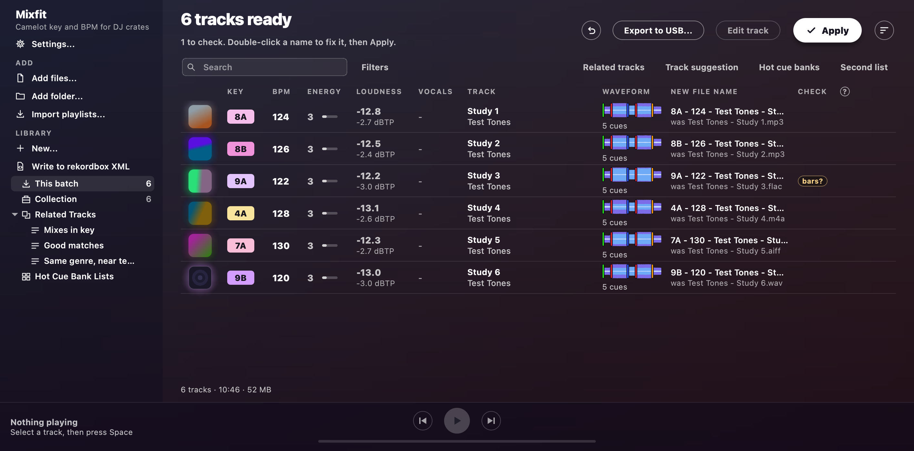

# Analysis

Mixfit measures each track's key, BPM, beat grid, energy, loudness, vocals and sections.
It also tells you when it isn't sure.
When you press Apply, Mixfit writes all this into your files.
[Tags, names and Apply](tags.md) shows what goes where.

## How it works

| Measure | What you get |
| --- | --- |
| **Key** | Camelot (8A) or musical (Am). It's read with a profile made for dance music, and a second reading cross-checks it. With [stems](#sharpened-by-stems), it's read from the bass and other sounds alone. |
| **BPM** | Worked out from the beat spacing over the whole track. Half and double time are corrected (87.5 → 175, 62 → 124). Then it's rounded to a whole BPM, with a half rounding up. |
| **Beat grid and bars** | An even grid on the kick. Bars start where the kick comes back after a break, where sections change and where the chords turn. A learned beat tracker gives a second opinion on the beat and the bar, which settles `bars?` where the two agree. With [stems](#sharpened-by-stems), where a bar starts is read from the drums alone. |
| **Energy** | A level from 1 to 10, as Mixfit's own estimate. See [Energy level](#energy-level). |
| **Loudness** | LUFS and true peak, which Mixfit only measures. See [Loudness](#loudness). |
| **Vocals** | About how much of the track has a voice, and where. It's a hint. With [stems](#sharpened-by-stems), it comes from the vocal's own level. See [Vocals](#vocals). |
| **Sections** | Intro, Verse, Build, Drop, Chorus, Groove, Break, Bridge and Outro. See [Phrases](#phrases). |
| **Names** | Artist and title, taken from the tags or from a file name read as `Artist - Title`. |

- The key is read at the track's own tuning, so a record pressed a little sharp still reads in its key.
  If the tuning is unclear, Mixfit falls back to A = 440 Hz.
  The tuning step is tested on generated tracks, but not yet on real music a person checked.
- The BPM range in [Settings](settings.md) decides where half-time and double-time readings fold to.
- Sometimes the sound can't tell which half of a beat the kick is on, or which beat starts a bar.
  Then you get `bars?` instead of a guess.
  To see how a grid that moves gets written, read [The beat grid in the XML](editor.md#the-beat-grid-in-the-xml).
- Before Mixfit reads a file name, it strips out track numbers, underscores and download clutter (`[Free Download]`, `www.site.com`, `320kbps`).

**Results are remembered** between sessions, both in the window and in the command line's `--csv` file.

- If you drop a folder in again, only new files get analysed, along with files whose size or modification time changed.
  The other files show `remembered` in the Check column.
- Results follow a track when you rename it in the window, and when you undo that rename.
  Remembered tracks still re-fold when you change the BPM range.
- Results live in your library (`~/Library/Application Support/Mixfit/library.db` on macOS, `%APPDATA%\Mixfit\library.db` on Windows), never in your music folders.
  [Library and playlists](library.md) has more about the library.
- An older version may have remembered a track without its energy, loudness or vocals.
  That track gets analysed once more the first time you add it after updating.
  Older rows in a `--csv` file get analysed once more too.
- Older versions of the window didn't keep where the tempo drifts.
  A track remembered from back then shows a general `bpm?` tooltip until it's analysed again.

## Checks

The Check column flags tracks worth a listen:

| Check | Means |
| --- | --- |
| `key?` | The key is uncertain. |
| `bpm?` | The tempo is unsteady. |
| `bars?` | Mixfit is unsure where the beat or the bar starts. |
| `grid?` | The grid from your rekordbox collection disagrees with Mixfit's. |
| `folded` | Half or double time was corrected. |
| `cleaned` | Another tool's key or energy text was removed from the name ([details](tags.md#key-and-energy-text-from-other-tools)). |
| `name?` | No artist was found. |
| `partial` | The file is over 40 minutes, so only the start is analysed. |

A track whose analysis was [sharpened by its stems](#sharpened-by-stems) also shows a quiet `stems`.

Hover a check to see the details for that track.
The tooltip shows where the tempo drifts (`Tempo drifts 122-126 BPM at 1:12-1:40 and 4:05-4:30`), the second key reading, the tempo before folding, or the text that was removed.
In the Check column, the arrow keys show the same tooltip.
Screen readers read the tooltip from the cell.
The `?` beside the Check heading lists every check.

- **`bpm?`** means the tempo confidence is low, or the grid strays from the BPM by over 1.2% for 8 seconds or more.
  You won't see `bpm?` when the kicks and bass hold an even grid through the whole track.
  That's because a beat tracker can wander through a breakdown even when the tempo never moved.
- **`bars?`** means the kick hits about as hard on the off-beat as on the beat, with no snare or clap on 2 and 4.
  It can also mean that nothing in the sound says which beat starts a bar.
  The tooltip says which of the two it is.
  Before it shows, a second opinion gets a say from [Beat This!](https://github.com/CPJKU/beat_this), a learned beat and downbeat tracker, which listens to the 15 seconds where the kick and bass are loudest.
  Where it agrees with Mixfit's own reading on the beat and on bar 1, and the kick and bass hold the grid through the track, the check clears.
  Where the two disagree, the check stays and the tooltip says what each of them hears.
  The second opinion never moves a grid on its own.
  It was checked on generated tracks whose bars are known, and against bar lines marked on the benchmark corpus from spectrograms, not yet by ear.
  Automix echoes out of and into a `bars?` track rather than risk a train-wreck.
  Set the track's grid in the [track editor](editor.md#track-editor) and the check clears.
- **`grid?`** means the grid your rekordbox collection, or an import, gave the track sits apart from the one Mixfit hears: half a beat off, bar 1 on another beat, or more than 20 ms away.
  Cues and the rekordbox XML use the imported grid.
  The tooltip says how far apart the two are.
  Open the track in the [track editor](editor.md#track-editor) to listen and set the one you trust.

With `--csv`, the `bpm_unsteady` column holds the `bpm?` tooltip text.
The `tempos` column holds the grid written to the rekordbox XML.

## Energy level

The Energy column shows how intense a track feels, from 1 (very chill) to 10 (a festival peak).
It's the same idea you'll know from Mixed In Key.
But it's Mixfit's own estimate, not Mixed In Key's number.
The two will often differ.

The estimate listens to the main body of the track, so an intro or breakdown doesn't drag it down.
It looks at three things:

- how much sound sits above 2 kHz (hi-hats, percussion, noise, sharp synths)
- how busy that high sound is
- how dense the master is

Tempo and loudness don't count, so a quieter copy of a track gets the same level.

**Know its limits:**

- The estimate was tuned to sort 14 genres sensibly.
  It has never been checked against Mixed In Key's numbers or listeners' ratings.
- The top of the scale is the weakest part.
  A 9 is rare, and no test track reached 10.
  The estimate can't reliably tell a peak-time track from an ordinary club one.
  Fast, harsh tracks read low (breakcore at 6 or 7).
- A dark track reads low however hard it hits.
  A bright, busy quiet track reads high (solo piano reached 4).
- You get one number per track, not one per section.

The Energy column is always there.
`--csv` and Export CSV have an `energy` column.
You can also use `{energy}` in [file name and title formats](tags.md#file-name-and-title-formats).

**Writing it into the comment is off by default.**
To turn it on, tick *Add energy to comment* under *On Apply*, or pass `--energy` with `--write-tags`.
The comment then becomes `8A - Energy 6 - promo copy`, with the level right after the key.
DJ software shows the comment, so you'll see the level there.

- The Comment column and `--dry-run` show the new comment before it's written.
- The window remembers the setting.
- Running it again replaces the level rather than stacking a second one.
- Every write is logged.
  Undo puts the old comment back.

**A Mixed In Key energy level already in a comment is never overwritten unless this option is on.**

- With the option off, only the key changes.
  For example, `10A - Energy 6 - promo copy` becomes `8A - Energy 6 - promo copy`.
  And `Energy 6 - 10A` becomes `8A - Energy 6`.
- On FLAC, Ogg and Opus files, Apply may clear a `DESCRIPTION` field that holds a level.
  When it does, the level moves to the comment.
- With the option on, the estimate replaces the existing level.
  Undo brings the old level back.
  A track with no estimate keeps its level.
- Mixfit can't tell who wrote a level.
  So turning the option off also leaves Mixfit's own earlier estimates alone.
  To take those out, use Undo.
- A level only counts at the start of a comment or right after a key, written as `Energy 1` to `Energy 10`.
  `Energy 52` is a name, so it stays.

## Loudness

The Loudness column shows each track's integrated loudness in LUFS, with its true peak in dBTP under it.
`--csv` and Export CSV have `lufs` and `true_peak` columns.
The command line also prints both as each track finishes.

- **Integrated loudness** (EBU R128) is one number for the whole track, with quiet stretches left out.
  A track at -8 LUFS plays about 4 dB louder than one at -12.
- **True peak** is the highest point the wave reaches, between samples too.
  Above 0 dBTP, a track can clip on the way out of a player.
  Loud masters often go above 0 dBTP.

A mono file reads the same as a stereo file with the same sound on both sides.
Silence, or a measurement that failed, shows `-`.
The rest of the analysis still stands.
For a `partial` track, the loudness covers only the part that was analysed.
On test tones and 115 real tracks, the loudness came within 0.1 LU and the true peak within 0.2 dB of a separate meter.
rekordbox has no LUFS figure to compare with.

**Mixfit only measures.**
No audio is changed, normalized or limited.
rekordbox's Auto Gain only works on its own decks.
On a CDJ or XDJ, you set the trim by hand.
The LUFS difference between two tracks tells you roughly how far to pump up the volume or pull it back.
To write the loudness into tags made for it, see [ReplayGain tags](tags.md#replaygain-tags).

## Vocals

The Vocals column shows about how much of a track has a voice, and a yellow line under its waveform marks where.
Sort by the Vocals column to find the instrumentals, which show `none`.
`--csv` and Export CSV have a `vocals` column (the share in percent) and a `vocal_parts` column (the parts in seconds).

**It's a hint.**
It can miss a voice, or hear one in a lead sound or a sample.
So trust your ears.
Nobody has marked the voices by ear yet, so there's nothing to check it against.
Where Mixfit and rekordbox disagree about a voice, rekordbox misses voices too.

- If the measurement failed, the track shows `-`.
  The rest of its analysis still stands.
- Vocal parts stay in the app.
  None of them go on a USB stick, because nobody has seen a player show vocal data.
- The same vocal listening also feeds the Collection Radar in [Track suggestion](library.md#track-suggestion).

## Sharpened by stems

A full mix can fool the analysis.
A vocal pickup or a loud stab can make a bar look like it starts a beat early, drums and vocals blur the notes the key comes from, and a lead synth can sound like a voice.
Turn on **Sharpen analysis with stems** in [Settings](settings.md#stems), and Mixfit splits each track into drums, bass, other sounds and vocal, and reads three things again:

- **Bar 1** from the drums alone. The beat grid stays where the full mix puts it.
- **Key** from the bass and other sounds, with no drums or vocal in the way.
  If that key differs from the full mix's, the track gets `key?`, and the tooltip shows both.
  A key the full mix already had doubts about keeps its `key?`.
- **Vocal parts** from how loud the vocal is on its own, where the voice model also hears a voice in it.

Sometimes a stem doesn't separate cleanly.
Then Mixfit keeps the full mix's reading for that part.
The track shows a quiet `stems` in the Check column either way, and its tooltip says what came from the stems and what didn't, and why.
A track you [locked](editor.md#track-editor) in the editor keeps its grid, cues and phrases.

**How far you can trust it.**
In testing, bar 1 from the drums got a few more tracks right and added no new mistakes it was sure of.
The key almost never changed, and when it did, the track got `key?`.
Vocal parts on generated tracks with a voice were much more accurate.
Nobody has checked bar 1, keys or vocals of real music by ear yet, so it's new: trust your ears over it.

**What it costs.**
It uses the same model as Automix's [stems moves](automix.md#stems), downloaded once after you agree.
It runs in the background, slowly, so it never gets in your way, and shows as **Separate stems** in Activity, where you can pause or cancel it.
It goes through your whole library, one track at a time, after anything Automix needs.
A track takes about a third of its length on an idle M1 Pro.
Only small measures are kept, about 50 KB a minute, and the separated audio is deleted straight away.
Files over 20 minutes, which are mixes rather than tracks, are skipped.

## Phrases

Each analysis splits a track into sections.
Like rekordbox, Mixfit calls them phrases.
Phrases show on the editor's strip.
They name the [cue points](editor.md#cue-points).
They guide [Automix](automix.md), whose mix points sit on phrase lines.
And they go on a USB stick for a player to show.
An XDJ-RX3 shows them with `WAVEFORM DIVISIONS` set to `PHRASE`.
rekordbox's XML has no place for phrases, so only a stick gets them.

| Section | What it is |
| --- | --- |
| **Intro** | The start of the track. It runs up to the track's first change if that comes within 16 bars. Otherwise it runs to the first phrase line from bar 8. |
| **Verse** | A stretch below main level with a voice over it. |
| **Build** | The stretch that leads up to a main stretch. |
| **Drop** | A main stretch the bass slams into, after a stretch without bass. |
| **Chorus** | A main stretch that a voice carries, even when the bass slams in. |
| **Groove** | A main stretch with neither a bass slam nor a voice. It's the steady body of most techno and house, where the groove is in the heart. |
| **Break** | A dip where the bass drops out. |
| **Bridge** | A dip that keeps its bass. |
| **Outro** | The way out after the last main stretch. On a track that never lets go, it starts at the first phrase line of its last 8 bars. |

- Sections come from how each bar's loudness, bass, mids, highs and voice move together.
- Every change lands on a four-bar phrase line.
  So does the end of an Intro or Outro.
  Phrase lines are never counted back from where the file stops.
- If nothing in a track changes enough to tell apart, the track is just an Intro, one long Groove and an Outro.
- Bars are always counted as the EDM range (89-178) reads them, whatever range you pick.
  So a track that's really under 89 BPM, like most hip-hop, is counted in half bars.
  Under the Hip-hop range, that means a section can start halfway through a bar.
- Mixfit's phrases agree with rekordbox's on a little over half of a track's length.
  Either one can be wrong.
  The usual differences are whether a stretch is a Build or a main stretch, and where a Break sits.
- You can cut, retype and clear phrases in the [track editor](editor.md#phrases).

**On a stick**, each section gets rekordbox's nearest label.
A track with a Verse or a Bridge goes on in rekordbox's mid mood, which has names for those two.
Every other track goes on in rekordbox's high mood.

| Mixfit | High mood | Mid mood |
| --- | --- | --- |
| Intro | Intro | Intro |
| Verse, Build | Up | Verse |
| Drop, Chorus, Groove | Chorus | Chorus |
| Break, Bridge | Down | Bridge |
| Outro | Outro | Outro |

## Waveforms

Each analysis also makes the track's waveforms for players.
You get blue, RGB and 3-band waveforms, each in full and as a preview.

- The Waveform column draws the track as one shape in three bands, so its sections show at a glance.
  Violet is bass, blue is mids, and a pale core is highs.
  The column shows in windows at least 1416 px wide, which is the default size where the screen has room.
  It also always shows while Make rekordbox cues is on.
- The editor and its whole-track strip draw the same shape.
  Kicks keep their height, and the part that's already played is dimmed.
- The yellow line under the waveform marks a voice, as [Vocals](#vocals) explains.
- On a player, the waveforms look a little different from rekordbox's.
  The height matches closely, and the colors are close approximations.

**Waveforms are kept** in the app data folder's `analysis` folder.
Each track has one `.wave` file (about 335 KB for 6 minutes).
Beside it sits a `.measures` file (about 300 KB) with what the analysis took from the audio.

- These files follow the audio, not the file it's in.
  So a track keeps them through a rename or a tag write.
  Copies of the same audio share one set.
- You can delete either file at any time.
  The track just gets analysed again when it needs them.
- The `.measures` file lets an update skip a fresh analysis when the update only changes sections or cues.
- Keep the `.edit` files, because they hold what you set in the [track editor](editor.md#track-editor).

Each time Mixfit starts, it clears out the waveforms and measures that no library track uses, such as those of removed tracks or changed audio.
This cleanup runs in the background.
Anything written in the last day stays, so a running analysis keeps what it made.
The cleanup never removes an `.edit` file.
So a track you add again gets its grid, cues and lock back.
