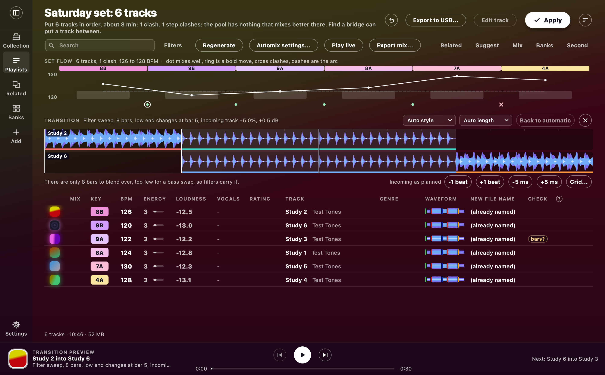
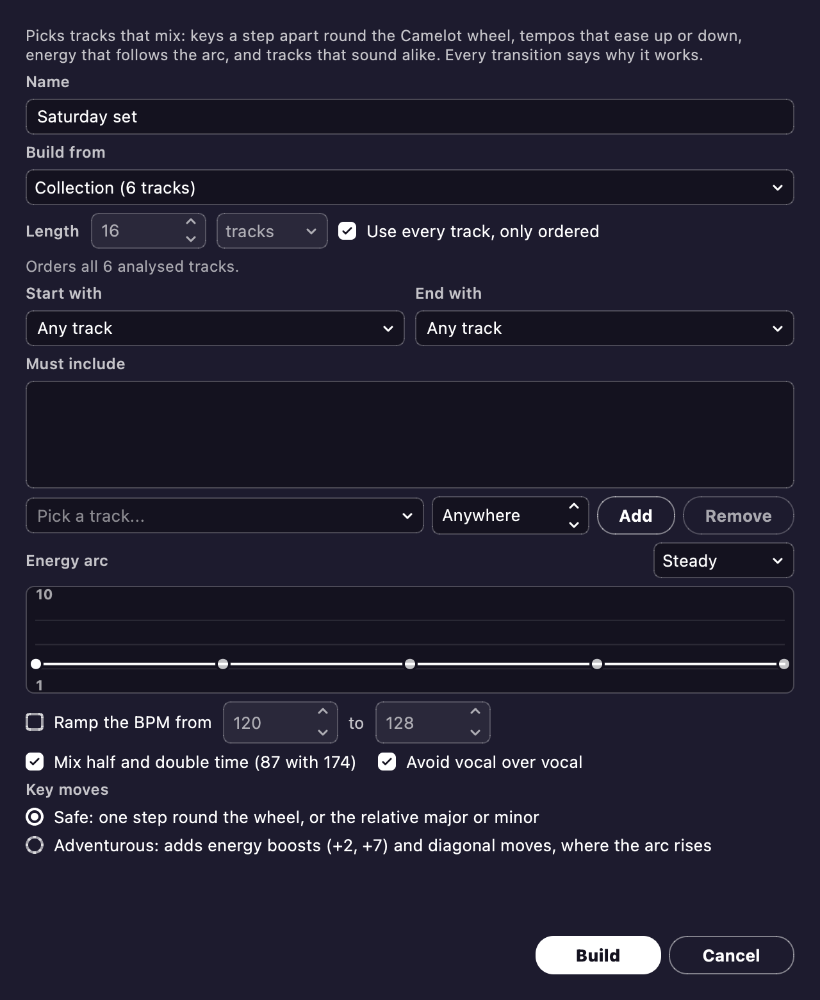

# Automix

Automix can help you plan a set.
It picks tracks that mix and puts them in an order where each track leads into the next.
You can preview any transition, play the whole set live as one mix, or render it to a file.
Is it terrible? Maybe. Robots built it, and you're human after all.

## Building a set

Start a set with **New Automix...**, from the sidebar's **+** or the Library menu.
You can also right-click a playlist and choose **New Automix from this...**.
Right-click a track for **Start an Automix with this...**, or a selection for **New Automix from the selected...**.

**The pool** is what Automix picks from: the collection, a playlist, matchlist or folder, or the selected tracks.
If the pool holds more tracks than the set needs, Automix picks tracks and orders them.
If it doesn't, or if you tick **Use every track, only ordered**, Automix just orders them.
When you start from tracks you selected yourself, Automix starts out only ordering them.
Set the length in tracks or in minutes, up to 200 tracks.
Minutes count at the pool's average track length, less 30 seconds per mix.
The line under the length tells you what Automix is going to do.

**What it scores.** Automix gives each step a score on these things:

- **Key.** **Safe** (the default) sticks to the same key, one step either way, or the relative key.
  **Adventurous** adds energy boosts (+2, +7), -2 and the diagonals (8A to 9B, 8B to 7A).
  It saves the boosts for where the arc rises.
  Staying in one key costs more each step, so a long set walks the wheel.
  A `key?` track counts as neither a match nor a clash.
- **Tempo.** A stretch under about 2% is nearly free, up to 5% is gentle, and past 8% it clashes.
  **Mix half and double time** lets 87 BPM meet 174 at a small cost.
  **Ramp the BPM** climbs or eases down through the set.
- **Energy.** Automix scores energy against an arc: **Steady** (the default), **Warm-up**, **Peak time**, **Journey** or **Wind-down**.
  You can also drag the arc's points, or use the arrow keys, to draw your own.
  A jump of more than one level costs extra, as Mixed In Key advises.
  Energy is only an [estimate](analysis.md#energy-level), so it counts for less than key and tempo.
- **Sound.** Tracks that sound alike on the Collection Radar follow each other more easily.
- **Voices and artists.** **Avoid vocal over vocal** keeps a voice in one track's last 30 seconds off a voice in the next track's first 30 seconds.
  With [stems](stems.md) on, it doesn't need to, because the blend can hold the incoming vocal out.
  The same artist never plays twice in a row.
  A short intro or outro (from the [phrases](analysis.md#phrases)) counts against a step.

The weights are hand-picked and haven't been tuned on real music yet.

**Pinned tracks.** You can pick a first track, a last one and any must-haves.
A must-have can go anywhere or at a set position.
Automix orders the rest of the tracks around your pins.
If a pin forces a clash, the status line names it.
If the pins need more than 200 tracks, the status line tells you how many it left out.

**The result** is a plain playlist.
You can edit it, or send it to rekordbox or a stick like any other playlist.
To keep a track in its slot, right-click it and tick **Locked in place**.
Then hit **Regenerate** for a fresh order around the locked tracks.
**Automix settings...** changes the rules and rebuilds the set, keeping the locks.

## Set flow

The set flow sits over any playlist, matchlist or folder, and draws its tracks in order.
Each track shows its key color, an energy bar and a tempo line.
A dashed line shows the energy arc Automix aimed for.
Under each step, a dot means the step mixes well and a cross means a clash.
A ring means a bold move: an Adventurous key move, a stretch over 5%, an energy jump, or voices overlapping.
The table's Mix column carries the same marks for each row against the track playing or selected ([Mix with](library.md#mix-with)).
Hover over a mark, or step along the marks with Left and Right, to see why.
The reason reads like `+1 on the wheel (up a fifth), -1.5% tempo, energy 7->8 (aim 8), sounds alike`.
Click a track to select it in the table.
When you reorder the playlist, the set flow rescores it straight away.
View > Set flow hides the set flow.

**Find a bridge.** Double-click a mark, press Return on it or right-click it.
You can also right-click two selected tracks.
Either way, you get a list of tracks that could go between them, best first, with the reasons.
**Insert** drops your pick in.
In an Automix, the suggestions come from its pool, or from the collection when nothing in the pool fits.
Anywhere else, they come from the collection.

## The rest of Automix

- [Transition preview](transitions.md): hear any step before you play it out, and change how it mixes.
- [Stems](stems.md): each track's vocals, drums and bass, for the stems moves, Play live's stem buttons and acapella and instrumental files.
- [Export mix](export-mix.md): the whole set rendered to one file.
- [Play live](play-live.md): the set as one continuous mix, with nothing rendered first.
