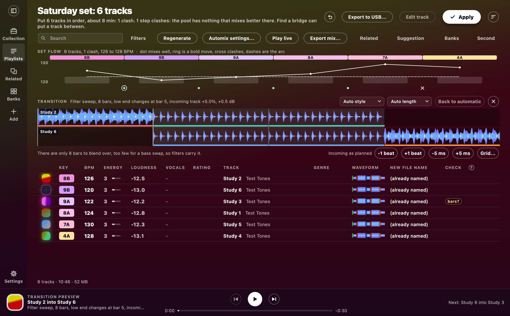
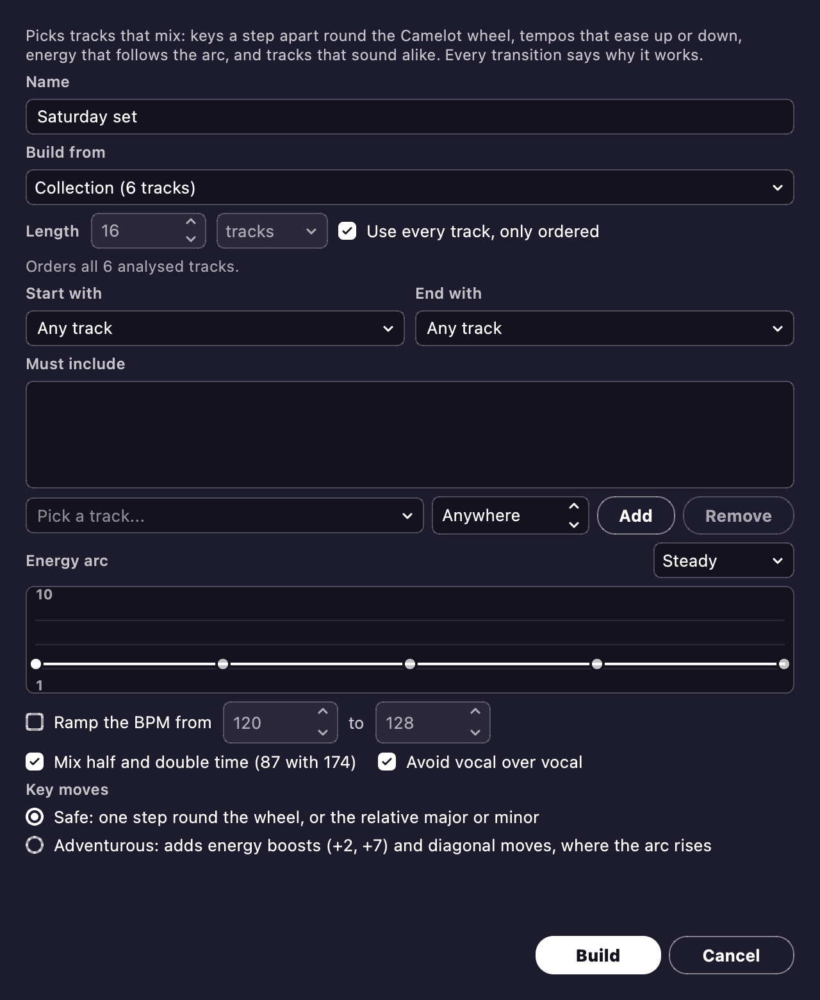

# Automix

Automix can help you plan a set.
It picks tracks that mix and puts them in an order where each track leads into the next.
You can preview any transition, play the whole set live as one mix, or render it to a file.
Is it terrible? Maybe. Robots built it, and you're human after all.

## Building a set

Start a set with **New Automix...**, from the sidebar's **+** or the Library menu.
You can also right-click a playlist and choose **New Automix from this...**.
Right-click a track for **Start an Automix with this...**, or a selection for **New Automix from the selected...**.

**The pool** is what Automix picks from: the collection, a playlist, matchlist or folder, or the selected tracks.
If the pool holds more tracks than the set needs, Automix picks tracks and orders them.
If it doesn't, or if you tick **Use every track, only ordered**, Automix just orders them.
When you start from tracks you selected yourself, Automix starts out only ordering them.
Set the length in tracks or in minutes, up to 200 tracks.
Minutes count at the pool's average track length, less 30 seconds per mix.
The line under the length tells you what Automix is going to do.

**What it scores.** Automix gives each step a score on these things:

- **Key.** **Safe** (the default) sticks to the same key, one step either way, or the relative key.
  **Adventurous** adds energy boosts (+2, +7), -2 and the diagonals (8A to 9B, 8B to 7A).
  It saves the boosts for where the arc rises.
  Staying in one key costs more each step, so a long set walks the wheel.
  A `key?` track counts as neither a match nor a clash.
- **Tempo.** A stretch under about 2% is nearly free, up to 5% is gentle, and past 8% it clashes.
  **Mix half and double time** lets 87 BPM meet 174 at a small cost.
  **Ramp the BPM** climbs or eases down through the set.
- **Energy.** Automix scores energy against an arc: **Steady** (the default), **Warm-up**, **Peak time**, **Journey** or **Wind-down**.
  You can also drag the arc's points, or use the arrow keys, to draw your own.
  A jump of more than one level costs extra, as Mixed In Key advises.
  Energy is only an [estimate](analysis.md#energy-level), so it counts for less than key and tempo.
- **Sound.** Tracks that sound alike on the Collection Radar follow each other more easily.
- **Voices and artists.** **Avoid vocal over vocal** keeps a voice in one track's last 30 seconds off a voice in the next track's first 30 seconds.
  With [stems](#stems) on, it doesn't need to, because the blend can hold the incoming vocal out.
  The same artist never plays twice in a row.
  A short intro or outro (from the [phrases](analysis.md#phrases)) counts against a step.

The weights are hand-picked and haven't been tuned on real music yet.

**Pinned tracks.** You can pick a first track, a last one and any must-haves.
A must-have can go anywhere or at a set position.
Automix orders the rest of the tracks around your pins.
If a pin forces a clash, the status line names it.
If the pins need more than 200 tracks, the status line tells you how many it left out.

**The result** is a plain playlist.
You can edit it, or send it to rekordbox or a stick like any other playlist.
To keep a track in its slot, right-click it and tick **Locked in place**.
Then hit **Regenerate** for a fresh order around the locked tracks.
**Automix settings...** changes the rules and rebuilds the set, keeping the locks.

## Set flow

The set flow sits over any playlist, matchlist or folder, and draws its tracks in order.
Each track shows its key color, an energy bar and a tempo line.
A dashed line shows the energy arc Automix aimed for.
Under each step, a dot means the step mixes well and a cross means a clash.
A ring means a bold move: an Adventurous key move, a stretch over 5%, an energy jump, or voices overlapping.
Hover over a mark, or step along the marks with Left and Right, to see why.
The reason reads like `+1 on the wheel (up a fifth), -1.5% tempo, energy 7->8 (aim 8), sounds alike`.
Click a track to select it in the table.
When you reorder the playlist, the set flow rescores it straight away.
View > Set flow hides the set flow.

**Find a bridge.** Double-click a mark, press Return on it or right-click it.
You can also right-click two selected tracks.
Either way, you get a list of tracks that could go between them, best first, with the reasons.
**Insert** drops your pick in.
In an Automix, the suggestions come from its pool, or from the collection when nothing in the pool fits.
Anywhere else, they come from the collection.

## Transition preview

**Preview transition** renders a step and plays it, so you can hear the mix before you play it out.
Press **Preview transition** over the table, press Space on a step's mark, or right-click the mark.
The preview opens under the set flow, or in its place in a short window.
It follows along as you walk the steps with Left and Right.

### Where the mix goes

Mixes stay on phrase lines, so a track never comes in on bar 6 of 8.
A phrase line is a phrase the analysis found, or a line every 8 bars counted on from one.
Phrase lines are never counted back from the end.

- The outgoing track leaves from its Outro or from the quiet [sections](analysis.md#phrases) before it, never mid-Drop, Chorus or Groove.
  The incoming track comes in before its first Drop, Chorus or Groove.
- A blend runs whole phrases: the longest of 8, 16 or 32 bars that fits.
  An outro a few bars short of 8 can run out under the blend.
- **Avoid vocal over vocal** shortens the blend or makes the outgoing track leave later, to keep the voices apart.
  When it can't, it holds the incoming vocal out of the blend using [stems](#stems).
  Without stems, it tells you it can't.
- If nothing lines up, the next best option goes, and the notes say so.
  Anything you set goes the way you set it.

The incoming track takes on the outgoing track's tempo, worked out from the two beat grids.
Those can be your grids from the editor or rekordbox too, and half and double time count as one.
The incoming track also takes on the outgoing track's loudness, by up to 6 dB.
Automix listens to both kicks and nudges the mix-in until they meet, so they don't flam.

### The style

Each pair gets a style from its keys, tempos, [sections](analysis.md#phrases), energy and voices.
The note under the lanes says why.
Automix goes down this table, and the first style that fits wins:

| Style | When | What you hear |
| --- | --- | --- |
| **Echo-out** | Tempos over 8% apart, keys clash, the tempo moves inside the blend, or a track is `bars?` | The outgoing track stops on a phrase line with a two-bar tail. The next track drops in, with no stretch past 8%. |
| **Double drop** | Both build to a Drop, keys mix (no `key?`), stretch 5% or less, energy within one, no voice on both | The incoming track starts 8 or 16 bars early so the drops land together. The lows swap on the drop, and the outgoing track takes as long again to cross out. |
| **Bass swap** | Stretch 5% or less, blend 16 bars or more | Mids and highs cross over the whole blend. |
| **Filter sweep** | A bigger stretch or a short blend | The outgoing track thins out as the incoming one opens up. |
| **Echo-out** | A `key?` track, and a voice in the first half of the blend's incoming part, where a clash shows first | As above. |
| **Loop out** | The outgoing track has no room left (it ends on its Drop, say), and the incoming one has room | The outgoing track's last bar loops for 8 bars and washes out in reverb. |
| **Hard cut** | Neither track has room | The outgoing track stops on its phrase line, and the next track comes in on the next beat. |
| **Vocal over** | Only to fix two clashing voices, or an outgoing track with no quiet phrase left | One track's vocal rides the other's instrumental for 8 or 16 bars ([stems](#stems)). |
| **Hats carry** | In place of a bass swap or filter sweep, when the incoming track has no steady kick in the blend and the outgoing one has ([stems](#stems)) | The outgoing kick and bass go halfway. Its hats carry the groove to the end, and the new drums come in on the phrase, so two sets of hats never meet. |
| **Drum swap** | The other way round: the outgoing track has no steady kick there and the incoming one has ([stems](#stems)) | The drums and bass swap halfway, and the music crosses over the whole blend. Two drum parts never play together, and nothing is filtered. |
| **Melodic layer** | Both keys the same and sure, and a blend of 16 bars or more ([stems](#stems)) | The incoming melody rises under the outgoing track over the first half. The drums and bass swap, the outgoing music goes over the second half, and the incoming vocal waits for the end. |
| **Stems bass swap** | Wherever a bass swap would go ([stems](#stems)) | The basslines swap whole at halfway, harmonics and all. An EQ bass swap lets their upper half cross over the whole blend. |

The stems styles need all of these:

- Both keys are sure, and a safe move apart.
- Neither track is `bars?`.
- The stretch is 5% or less.
- The stems measure clean there: a track's music without its own drums must hold no kick, or it would flam with the other track's kick.

In any blend where two voices would meet, and **Avoid vocal over vocal** is on, the incoming vocal waits for the end of the blend, using stems.
The note says when that happens.

When two tracks' beats sit a beat apart, it's a train-wreck, worse than no beat at all.
So every style but echo-out needs both grids to hold.
The lows always swap in half a beat, so two basslines never boom together.
The tracks cross at equal power, so two loud masters don't hammer the limiter.
Only one pair has been judged by ear so far.
So treat the style as a guess, and overrule it when your ears disagree.

### Changing it

Both tracks share one timeline at the speed they play, so the beats line up.
Whatever won't be heard is dimmed.
On the lanes, colored bands are [phrases](analysis.md#phrases) and yellow is a voice.
White marks the mix point, red marks the bass swap, and the pale band is the blend.

- Slide a track to move its mix point.
  It snaps to phrase lines, to bars with Shift, and to beats with Alt.
  The outgoing track holds still.
  The incoming track can slide past the mix point to come in later, and it stays silent until then.
- Or Tab to the lanes and pick a track with Up and Down.
  Move it with Left and Right, by bars, or by beats with Shift.
- Click to move the playhead.
  Space or Play on the [player bar](window.md#the-player-bar) plays and pauses, and Esc closes the preview.
- **Auto style** and **Auto length** choose for you.
  **Back to automatic** forgets your changes.
  A style you pick sticks as best it can.
  For example, a double drop with no drops runs as a bass swap, and says so.
  A loop-out can run 16 or 32 bars.

**Fine adjustment** fixes a grid that's a little off.
It has **-1 beat** and **+1 beat**, and **-5 ms** and **+5 ms**.
In the lanes, Alt with Left and Right does the same, and adding Shift moves 1 ms.
A readout shows how far that is from the plan.
**Grid...** fixes the chosen track's own grid, like the [track editor](editor.md#track-editor) does.
It moves bar 1 a beat either way, or the whole grid 5 ms.
Every mix with that track gets the fix, and so does rekordbox.
**Open in the track editor** goes further.

Your changes stick for that pair, in that order.
They last through restarts, Regenerate, renames and reorders.
If you change a transition while it plays, it restarts.

### When a tempo moves

A blend only needs a steady beat where it runs, so drift anywhere else costs nothing.
Drift inside the blend means an echo-out.
A track with no grid but with phrases still mixes wherever a grid through those phrases holds.

### What it won't do

A track with no grid and no phrases can't be mixed.
Automix tells you why, and plays nothing until you set a grid in the [editor](editor.md#track-editor).
The notes flag unsure keys and tempos, and stretches big enough to hear.
The bundled ffmpeg stretches with [Rubber Band](https://breakfastquay.com/rubberband/), which takes a second or so.
If you run from source without Rubber Band, Automix falls back to `atempo` and says so.
That fallback is plainer on drums.

### Stems

Stems are a track's vocal, drums and bass, separated from it once.
The fourth stem is everything else: the track minus those three, so the four always add up to the track.
Stems power Vocal over, the four stems styles and a vocal held out of a blend, all [chosen with the style](#the-style).
They also give Play live its [stem buttons](#play-live), and the editor its [cues from stems](editor.md#cues-from-stems).

Vocal over lays one track's vocal over the other's instrumental, either way round.

- **Carried out:** the outgoing track stops on a phrase line in or after its last main section.
  Its vocal carries on over the incoming intro.
  The intro's own vocal stays muted.
- **Carried in:** the incoming vocal arrives early over the outgoing instrumental.
  The incoming track's own instrumental drops in on its first main section.

Vocal over needs all of these:

- Both keys are sure, and a safe move apart.
- Neither track is `bars?`.
- There's a voice through the bars the vocal rides.
- The vocal is stretched 2% at most.
- The separated vocal has no kick standing out.

If any of that's missing, another style goes, and the note says why, like `A Vocal over would help here, but stems still being prepared.`
A solo vocal shows separation mistakes worst, so this is the riskiest move Automix makes.
Nobody has judged it by ear yet.

The stems styles swap a track's stems one at a time, at the blend's halfway point.
Automix reads whether a track has a steady kick from its separated drums.
Sometimes the separator leaves part of a bassline in the rest of the track.
That part crosses the way an EQ bass swap would, so a stems bass swap never sounds worse than an EQ one.
Each stems style is a rule taken from what DJs and stems research say, and none has been judged by ear yet.
So pick another style if your ears say so.

Every stems move sounds the same in the preview, in [Export mix](#export-mix) and in [Play live](#play-live).
In Play live, a skip lets it play out like an echo-out.

Turn on **Separate stems for Automix** in [Settings](settings.md).
The first time, Mixfit asks before downloading the [HTDemucs](https://github.com/adefossez/demucs) weights (84 MB).
Their author says "The model weights are not covered by the MIT license, and are provided only for scientific purposes" ([the statement](https://github.com/facebookresearch/demucs/issues/327)).
The Demucs README adds that "the license of the weights is not clear" because the weights learnt from research-only data.
So the app doesn't ship them.

- Separation runs as **Separate stems** in Activity, at the lowest priority, with Pause and Cancel.
  It waits while an analysis runs.
- It only does the playlist on show, but the whole of each track, so you can mute a stem anywhere in it live.
  On a busy machine, a set of twenty five-minute tracks takes about 80 minutes.
  A track cut off by quitting starts over.
- A track's stems take about 16 MB per separated minute in the app data folder's `stems`, never next to your music.
  Backups leave them out.
  Settings shows their space and caps it, 10 GB unless you choose, removing the least recently used first.
  **Clear stems** deletes them, but the cues found in them stay.

### Acapella and instrumental files

Right-click tracks in the table and choose **Export acapella...** or **Export instrumental...** to save either as a file of its own, for edits or a [mashup](library.md#mashups).
For one track you pick the file, which starts beside the track as `<its name> (Acapella).flac` or `(Instrumental).wav`; for several you pick a folder, and a name already there gets a number rather than being replaced.
Nothing is ever written over the track itself.
This works whether or not **Separate stems for Automix** is on; the first time, Mixfit asks before it downloads the model, as above.
The whole track is separated, in the same **Separate stems** job and ahead of what Vocal over is waiting for, which takes about a minute a track; the status line says where each file went.

The acapella is the separated vocal, for when a voice is better off alone.
The instrumental is the track with that vocal taken out, so play the two together and you get the original back, however well the separation went.
The instrumental is a 32-bit float WAV because taking the vocal out can push it past full scale, and a normal WAV would clip there; a DAW opens it, though some players don't.
Both start where the track's grid and cues do, so they line up with the track and with each other.
Separation isn't perfect: a little of the beat can stay in the acapella and a little voice in the instrumental.

## Export mix

**Export mix...** sits over the table on any list with a set flow, and in the Library menu.
It mixes each step the way [Transition preview](#transition-preview) plans it, with your changes.
First it shows you which steps to watch.

**Render mix...** writes the set to one MP3 (320 kbps), FLAC or WAV file.
It runs about 80 times faster than the set plays, with a progress bar and Cancel.

- Each track is brought to the set's median loudness (by up to 6 dB).
  One limiter holds the whole set's peaks.
- After each blend, the incoming track glides back to its own tempo over 16 bars, so the BPM ramp holds.
  Without Rubber Band, it steps back at the blend's end.
- A track that's still blending in doesn't start leaving.
  The next mix waits for the next phrase line, and the export says so.
- A step that can't be planned gets an 8-second crossfade, and the export says why.

**Shift a track a semitone where that lifts a key clash** stays off until you tick it.
It needs Rubber Band.
It shifts as few tracks as it can, a semitone each.
It plans across the whole set, so one fix doesn't cause another clash.
It lists the shifted tracks, and it leaves `key?` tracks alone.
Only the mix file hears the shift.
The preview, your tracks and the cues keep their keys.
DJs rarely do this, and a shifted track goes through Rubber Band from start to finish.
That's why it's opt-in.

**Write rekordbox cues** adds the set to rekordbox's XML as a playlist under the list's name.
Each track gets **Mix in**, **Mix out** and, where the lows swap, **Bass swap** memory cues.
Hot cues stay, and no file is copied.
rekordbox replaces a track's cues on import.
So these mix cues go in next to the cues rekordbox already holds.
For that, choose your rekordbox collection in Settings, as [Cue points](editor.md#cue-points) explains.
A track holds 10 memory cues, and yours stay.
So the status line tells you how many mix cues didn't fit.
Each write replaces the last set's cues and whatever was waiting in the XML.
**Undo last Apply** takes the write back.

**Export to USB...** puts the set on a stick in order, with the same memory cues and no rekordbox needed.
It goes through the usual [Export to USB](usb.md#export-to-usb) window.
Mix cues fill the slots left after the cues each track gets anyway, which are yours plus *Make rekordbox cues*.
The export tells you how many mix cues didn't fit.
Old mix cues from rekordbox come off, and your own cues with the same names stay.

## Play live

**Play live** sits over the table on any list with a set flow.
It plays the set as one continuous mix, from the selected track or the top, with nothing rendered first.
Each mix goes the way [Transition preview](#transition-preview) plans it.
Play live also adds what [Export mix](#export-mix) adds: median loudness, the tempo glide, and a crossfade where a step can't be planned.

The [player bar](window.md#the-player-bar) shows what's playing, what's next, how soon and in what style.
It marks the next mix on its bar, and it stays on the set while you browse.
The set flow rings the track that's playing and the step being mixed.
The table shows a pause sign on the playing track's cover.

- **Click or drag** on the player bar to jump around the track.
  Click or drag on the set flow to jump anywhere in the set.
  A track's column runs from the middle of the mix in to the middle of the mix out, so dragging over a step runs through the mix.
  You can also Tab to the player bar and jump 10 seconds with Left and Right.
- **Next** mixes into the next track at the next phrase line, over 8 bars.
  Press it again to go at the next bar.
  During a mix, **Next** finishes the mix in a bar.
  While a track is still gliding back to its tempo, **Next** echoes out.
  An echo-out or hard cut can't be rushed, and the status line says so.
- **Reorder** the set by dragging or sorting, or add or remove tracks.
  You can even remove the playing track, which plays on until its mix.
  The set picks up from the next mix not yet started.
- **Pause** holds the set, and so does playing anything else or opening the editor.
  **Stop** ends the set.
- A track that can't be read gets skipped, and the status line says so.
- **Stems**: a row over the player bar has **Vocals**, **Drums**, **Bass** and **Rest** for the playing track and the next one, once their [stems](#stems) are ready.
  Click one to mute it, and click again to bring it back.
  Shift-click or right-click solos it, and the same again brings the others back.
  Ctrl+1 to Ctrl+4 (⌘ on a Mac) press the playing track's buttons, and Ctrl+5 to Ctrl+8 the next track's.
  What you set stays with the track, so you can mute the next track's vocal before it comes in.
  A muted stem is struck through, and a soloed one is filled.
  A track whose stems aren't ready, or that started before they were, has its buttons off and says why.
  A stems move plays its own stems, so the buttons wait until it's done.
  You hear a press within about 46 ms, and each stem fades over 23 ms, so it never clicks.

Key shifts are only for rendered mixes, so tracks play live at their own pitch.
Play live plays through the [Audio output](settings.md#audio-output) in Settings.
If you change the output, Play live follows it without losing its place.

### Under the hood

The live sound runs in its own process, so nothing the window does can make it stutter.
