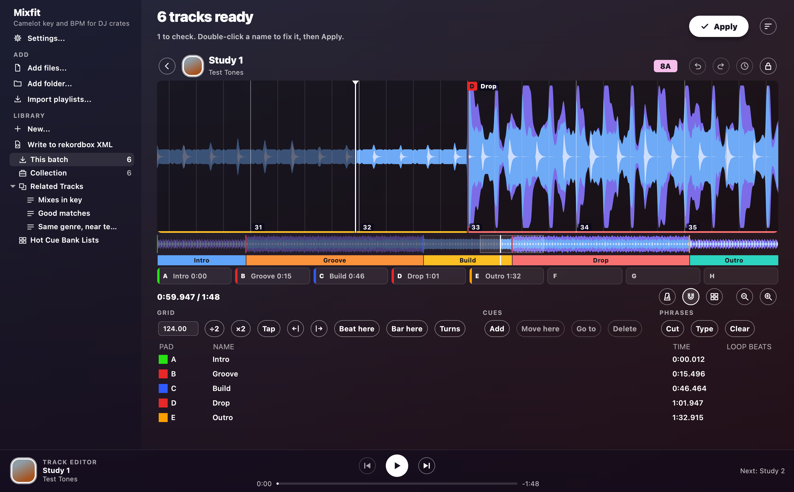

# Track editor and cues

The track editor is where you listen to a track and fix its beat grid, cues and phrases by ear.
Apply gets cue points ready for rekordbox.
Those cues can come from the analysis, from your own habits or from what you set here.

## Track editor

To open the editor, select a track and press E (Return on Windows, Cmd+Down on macOS).
You can also double-click the track's waveform or hit **Edit track**.
The back arrow or Esc takes you back to the table.
**Previous** and **Next** on the [player bar](window.md#the-player-bar) step through tracks.
Hover over any button and its tooltip shows the button's name and key.
A screen reader also reads out the drift band and the vocal parts, which are described below.
Apply and the sidebar stay in reach while the editor is open.
While Apply or Undo runs, the editor grays out and waits, and the status line shows a note.
When the run finishes, the editor reopens right where you were.

### Hearing it

**Play** is the round white button on the player bar.
Click the waveform, the whole-track strip or the player bar to move the playhead.
Drag the waveform to look around, and scroll it with the wheel.
To zoom, use the magnifier buttons, press **+** and **-**, or hold Ctrl or Cmd and turn the wheel.
What you hear lines up exactly with the grid.
A stock player would be slightly off.
**Click** (the metronome button) adds a metronome that ticks higher on a bar's first beat.
Play, pause, jumps and the end of a track all fade softly.
Even so, you still get a click on the first beat after Play.
Sound goes to **Audio output** in [Settings](settings.md#audio-output).
If you change the output mid-play, the sound follows you.
If there's no output, the status line says so and the playhead keeps running.
Playback is tuned not to pop, crackle or drop out, Bluetooth included.

### The grid

The beat lines show the grid exactly as it will be written.
Bar lines are stronger and numbered.
White lines are where the analysis put them.
Mint lines are yours: a line you moved, or a bar line on what was a plain beat.
After you set a new tempo, the beat that the BPM box kept stays white and the rest go mint.
**Back to the analysis** in History turns them all white again.

- **BPM** sets the tempo to two decimals and keeps the beat nearest the playhead in place.
  So park the playhead on a beat you trust first.
- **÷2** and **×2** halve and double the tempo, keeping bar lines on bar lines.
- **Tap** takes a tempo from four or more taps.
  While the track is playing, the grid lands on your taps too.
- The two arrows shift the whole grid 5 ms earlier or later, or 1 ms with Shift.
- **Beat here** puts the nearest beat on the playhead, and **Bar here** makes it the first beat of a bar.
- **Turns** adds or removes a tempo change at the nearest bar.

If a track's tempo moves, the track opens with its grid already turning.
Each turn is tagged with its tempo.
On such a track, the BPM box shows the tempo of the stretch around the playhead.
BPM, Tap and **Beat here** only change that stretch.
The nudges still move the whole grid.
A track with no grid gets one from the first BPM you type or tap, starting at the playhead.

A pink band along the top of the whole-track strip marks where the tempo drifts.
It marks the same stretches that the `bpm?` check names, so don't mix there.
The band is solid pink at 5% off.
Hover over it to see the tempos and times.
The band stays put while you edit the grid.
A track analysed by an older version shows no band until you analyse it again.

### Hot cue pads

Under the phrase strip, eight pads A to H show the hot cues, just like rekordbox's HOT CUE panel.
Each pad is edged in its cue's color and shows the cue's name and time.

- Click a pad, or press **1** to **8**, to jump to its cue.
  On an empty pad, the same click or key sets a new cue at the playhead.
  While **Snap to beats** is on, that new cue goes on the nearest beat.
- Hold Shift with the click or key to move the pad's cue to the playhead, keeping its name, color and loop.
- The keys go by position, so Shift+1 is pad A on any layout.
  That holds even on a French layout, where that key types &.
- Right-click a pad to pick its color.
  You can undo pad changes.
  On a locked track, the pads only jump.
- In a really short window, the pads hide.
  The keys still work, and the list still shows every cue.

### Vocals on the waveform

A yellow line along the foot of the waveform and the whole-track strip marks where the analysis hears a voice.
It's only a hint, and [Vocals](analysis.md#vocals) says more.

### Cues

The cue list shows the track's cues, earliest first.
Each row has the cue's pad, name, time and loop length.
In a narrow window, the list's buttons move up next to the playhead's time.

- **Add** drops a cue at the playhead on the first free pad.
  Once the pads are full, it adds a memory cue instead.
  A track holds 8 hot cues and 10 memory cues at most.
- To move a cue, drag its flag on the waveform or use **Move here**.
  With **Snap to beats** (the magnet) on, the cue lands on a beat, unless you hold Alt.
- Double-click a cell, or press F2 (Return on macOS), to edit the cue.
  You can rename it, type its time, change its pad or give it a loop in beats.
  Two cues can't share a pad, so if you pick a taken pad, the two cues swap.
- Right-click a cue or its flag to pick a color.
  A hot cue can have one of rekordbox's 16 hot cue colors.
  A memory cue can have one of the 8 track colors, or none.
  The colors go to rekordbox, to a USB stick and to a hot cue bank.
  rekordbox may drop a memory cue's color on import, though.
- **Go to** jumps to the selected cue.
  **Delete** or the Delete key removes it.

| Key | What it does |
| --- | --- |
| Space | Play or pause |
| Left, Right | Step back or forward a beat, or a bar with Shift |
| + and - | Zoom |
| M | Turn Click on or off |
| T | Tap |
| C | Add a cue |
| 1 to 8 | Go to the hot cue on pad A to H, or set one at the playhead on an empty pad |
| Shift + 1 to 8 | Set the pad's hot cue at the playhead, moving one already there |
| P | Cut the phrase at the nearest bar, or at the playhead with Snap to beats off |
| J | Combine the phrase at the playhead with the next |
| [ and ] | Move the grid 5 ms, or 1 ms with Shift |
| Ctrl or Cmd + Z | Undo, or redo with Shift |
| Esc | Go back to the table |

### Phrases

The strip under the whole-track view shows the track's [phrases](analysis.md#phrases).
A thin band under the waveform repeats them.

- **Cut**, or P, splits the phrase at the playhead into two phrases of the same type.
  While **Snap to beats** is on, the cut lands on the nearest bar.
- To move the line between two phrases, drag it on the strip or the band.
  The line lands on a bar line unless you hold Alt.
  Drag it onto the next line and the two phrases merge.
  The merged phrase takes the type of the one you grew.
- J merges the phrase at the playhead with the next one, keeping the type of the phrase at the playhead.
- **Type** changes the phrase at the playhead to any section in [Phrases](analysis.md#phrases).
  Under **Type**, **Fill-in** marks the last 1 to 4 beats of the phrase as a fill leading into the next phrase.
  A fill-in shows hatched, and **Fill-in** also takes it off again.
  As in rekordbox, only an Intro, Verse, Build, Drop, Chorus or Groove with a phrase after it can have a fill-in.
  Fill-ins are yours to mark, because the analysis doesn't find them.
  If you move or cut a phrase's end, or give the phrase a type that can't have a fill-in, its fill-in comes off.
- **Clear** removes every phrase except the Intro, which then runs the whole track.
  Then you can cut and type your own phrases.

You can undo phrase changes.
Phrases stay put when you change the grid.
They go onto a USB stick with their fill-ins.

### Keeping it

Every change saves straight away, so there's nothing to press.
The editor keeps your changes in a `.edit` file next to the track's waveform.
**Undo** and **Redo** step through your changes.
They're the round arrows, and they're also in the Edit menu, which names the change.
A run of nudges or taps counts as one change.
**History** (the clock) takes you back to any of the last 50 versions, or to the analysis.
Going back is itself a step you can undo, so you can re-rewind as often as you like.
Edits follow the audio, so they survive a rename, a tag write and a new analysis.
Copies of a track share its edits.
New audio under the same name starts fresh.

An edited track gets a pencil in the Check column of its row.
The table, tags and names pick up the new tempo, as a whole number.
With **Make rekordbox cues** on, Apply sends the grid and cues to rekordbox, as [Cue points](#cue-points) explains.
The cues you set here are the only cues the track gets, and they replace any cues it had.
Each cue goes on the pad you gave it, whatever kind of cue Settings makes.
A cue you didn't touch moves with the edited grid.
If a track has cues of its own in your rekordbox collection, it opens with those cues.
If you only change its grid, those cues stay.
The command line doesn't read these edits.

### Lock

**Lock** (the padlock) freezes a track's grid, cues and phrases until you unlock it.
A locked track's row shows a padlock.
You can still play a locked track.
It won't be analysed again when its file changes.
If an update changes the analysis, the track is measured once more, but it keeps its cues and phrases.
If the library remembers a track from before the app kept waveforms, that track gets analysed again once, the first time you open it.

## Cue points

Tick **Make rekordbox cues** under *On Apply* (`--cues` on the command line).
Apply then gets cue points ready for rekordbox.
They can be hot cues, memory cues, or both in the same places.

| Pad | What is there |
| --- | --- |
| A | The Intro |
| B | The first main section |
| C | The dip after it |
| D | The second main section |
| E | The Outro |
| F | The third main section, for a track that has one |
| G and H | Left for loops |

A pad means the same thing on every track.
Each cue is named for what's there.
For example, pad B says Drop, Chorus or Groove, and pad C says Break, Bridge, Verse or Build.
A second dip only gets a memory cue, because the pads are full by then.
Cues come from the [sections](analysis.md#phrases) and sit on bar lines.
The Intro cue goes on the first beat with sound.
A short fill doesn't count as a dip.
A track with no clear sections only gets its Intro cue, because no cue beats a wrong one.

The Waveform column shows where the cues will land before anything is written.
The cues show as ticks in their colors, and you can hover over the ticks for the times.
Cues you set in the editor stay.
A locked track's cues stay too.
If an update changes how cues are placed, Mixfit redoes them quickly, with no new decode.
New section names need one new analysis.
Cues that Mixfit already sent to rekordbox count as the track's own.
To replace them, take them out first with `--remove-cues`.

The controls under the **Make rekordbox cues** tick follow rekordbox's *CUE Analysis* preferences:

| In the window | Command line | What it does |
| --- | --- | --- |
| Hot cues, Memory cues, or Hot and memory cues | `--cue-type hot`, `memory` or `both` | Picks which kinds of cue Apply makes |
| At the sections, or Every 4 to 32 bars | `--cue-every BARS` | Instead of the sections, puts a cue every so many bars from the first bar, as rekordbox's Manual mode does. Up to 8 hot cues and 10 memory cues |
| No loops, or 2-bar to 16-bar loops | `--cue-loops BARS` | Adds an Intro loop from the first bar and an Outro loop from the Outro, on pads G and H and as memory loops |
| First bar memory cue | `--first-bar-cue` | Adds a memory cue on the first bar, even when you make hot cues only. rekordbox calls this *Set to 1.1 Bars* |
| Name the cues | `--no-cue-comments` to turn off | Writes the comment a player shows beside a cue |
| Memory cues from stems | `--no-stem-cues` to turn off | Adds memory cues named Vocal in, Vocal out and Breakdown to a track separated into stems, as [Cues from stems](#cues-from-stems) explains |
| Like my own cues | None | Puts cues where you'd put your own, as [Learning your own cues](#learning-your-own-cues) explains |

The first bar is the first one with sound, past any silence or pickup.
Bar cues get rekordbox's names: `1.1Bars`, `1.1Bars+8`, `1.1Bars+16`.
Bar cues count on the grid the track will end up with.
That's rekordbox's grid if your collection export has it, and Mixfit's grid if not.
A track with no grid says `no grid` and gets no bar cues, loops or first bar cue.
A loop that would run off the end is left out.
So is a memory cue on a spot that already has one.

### Cues from stems

A track separated into [stems](automix.md#stems) gets memory cues where its stems say something changes, each on a bar line of its grid:

- **Vocal in**: a vocal comes in after at least 8 bars without one, which also marks where a vocal-free intro ends.
- **Vocal out**: the last vocal ends with at least 8 bars to go, the start of a vocal-free outro, where the next track's vocal can come in.
- **Breakdown**: the drums drop out for at least 4 bars after at least 8 bars of them, and come back later.

A single bar without a vocal or drums, a breath or a fill, doesn't count, and nor does a single sung bar.
A vocal from the first bars gets no Vocal in, and drums that stop for the end are an outro, not a breakdown.
These cues are a hint: nobody has checked them by ear.
They are memory cues, so they leave your pads alone and take the room left of a player's 10, and cues you set in the editor stay as they are.
They come from the stems the first time a track is separated, or filled in quietly for a track separated before that was possible, and stay with its analysis when its stems are cleared.

### Getting cues into rekordbox

rekordbox doesn't read cues from tags.
Instead, the cues get in through a rekordbox XML that you import, the same way Mixed In Key's cues do.
Apply writes `rekordbox-cues.xml` in the app data folder, and your audio files don't change.
**Show cue file** opens that folder.

Set up the import once:

1. In rekordbox, open Preferences > Advanced > Database and press **Browse** next to *Imported Library*.
   Then choose `rekordbox-cues.xml`.
2. Open Preferences > View > Layout and tick *rekordbox xml* under *Media Browser*.

Then after each Apply:

1. Open the **rekordbox xml** icon in the browser's left strip.
   Press its refresh button.
2. Open **All Tracks**, or Playlists > *Mixfit cues*, and select the tracks.
3. Right-click and choose **Import To Collection**.
4. For a track already in your collection, rekordbox asks `This track already exists in the current collection`.
   Choose **Yes** to load the cues.
   Tick *Don't ask me again* if it's a long list.
   For a new track, rekordbox asks about analysis instead, and OK is fine there.

Choosing Yes replaces that track's cues and grid.
That's why each Apply's file only holds that Apply's batch of tracks.
Apply also warns you that it can't see anything you set in rekordbox since your export.
Import each batch once.
An old batch would overwrite whatever you've changed since.

**Your own cues are safe.**
If a track has hot cues, loops or memory cues of its own in your collection export, it stays out of the XML.
Its row says `keeps its own`.
The exception is a track you change in the [track editor](#track-editor).
rekordbox's automatic first-beat memory cue doesn't count as your own, and it stays where it is.
Mixfit skips Ogg, Opus, WMA and raw AAC files, because rekordbox can't load them.

### The beat grid in the XML

For tracks that rekordbox has analysed, pick a collection export under *rekordbox collection* in [Settings](settings.md).
Make that export with *Export BeatGrid information* ticked in rekordbox's Preferences > Advanced.
Cues then land on the grid that rekordbox already has.
The track's name, tags and grid go into the XML exactly as rekordbox wrote them, so the import changes nothing else.

Without an export, the XML carries Mixfit's own grid at the BPM that Mixfit shows.
For example, a track heard at 87 BPM that Mixfit folds up to 174 gets a 174 BPM grid.
That grid has twice the beats and the same bar lines.
The grid's tempo is a whole BPM when the beats fit one, as on most music.
When they don't, the tempo has two decimals (`174.60`).
A steady track gets one tempo.
A track whose tempo moves gets a tempo change at each bar where it turns.
A track with no grid worth trusting goes in without a grid, and rekordbox works out its own.
The grid sits on rekordbox's own timeline, MP3 header frames included, so it doesn't shift on import.
A few tracks have an off-beat as strong as the kick and no snare or clap on 2 and 4.
On those tracks the grid can sit half a beat off, so check them by ear.

### Taking cues out again

Undo last Apply puts `rekordbox-cues.xml` back how it was.
Once rekordbox has imported the cues, take them out with **Cue history...** ([below](#cue-history)) or `--remove-cues`.
Both pull Mixfit's cues off lots of tracks at once and keep yours.
rekordbox has no menu item for that.
Both need a fresh collection export, and both go through the same import.
If a track is left with no cues, it gets rekordbox's own first-beat memory cue.
That's because rekordbox ignores an import with no cues.

### Learning your own cues

**Like my own cues** puts cues where you'd put yours, like rekordbox's personal CUE trend.
To set it up, press **Learn my cues...** under the cue controls.
Then pick the tracks to learn from: the whole Collection, or a folder or playlist.
Mixfit learns only from cues you set yourself.
Those cues can come from the [track editor](#track-editor), an [import](library.md#importing-from-rekordbox-apple-music-playlist-files-and-a-players-history) or your rekordbox collection.
It never learns from Mixfit's own cues or from rekordbox's automatic first-beat cue.
It needs 5 tracks with your cues.
With 30 or more tracks across genres, it learns better.
Learn again after you've cued more tracks.
**Forget my style** drops what it learnt.

Mixfit learns each cue as a distance from the track's landmarks, like 16 bars before the first chorus.
Then it places the cue the same way on new tracks.
A Drop and a Chorus count as one here, so a habit on one carries over to the other.
A pad only gets a cue if you use that pad on at least half your tracks, and at least a quarter of them agree on where.
Hot cues keep their pad and your usual name, color and loop.
Memory cues are learnt up to as many as you usually set.
Loops stay off your pads.

Learning works best when you hear phrases where Mixfit finds them.
If you cue on rekordbox's phrases, it places far fewer cues, and only about half of them land on the beat.
Check learnt cues in the Waveform column before you Apply.

### Cue history

rekordbox has no undo for a deleted cue, and its Restore Library swaps out the whole library.
So Mixfit keeps a history of your cues.
Each collection export you choose adds to `cue-history.json` in the app data folder.
That file keeps up to 20 earlier sets of cues per track, until you delete it.
The window reads the chosen export every time it starts.
The history only knows what your exports knew, so export before anything risky.

When a new export has fewer cues on a track than the last one did, the status line and Settings tell you.
**Cue history...** lists the tracks that lost cues and lets you pick how far back to go.
It also lists tracks that have Mixfit's cues, and offers the choice *Without Mixfit's cues*.
Mixfit knows its own cues by exactly what it wrote.
So a track cued before this history existed, or cued by an older version, stays off that list.
Your cues never get mistaken for Mixfit's.
Tracks that just lost cues start ticked.
The rest start unticked, like a track where you deleted a cue on purpose.
Ticked tracks go into `rekordbox-cues.xml` for the usual import, with the old cues next to today's.
An old hot cue whose pad is taken comes back as a memory cue.
Mixfit follows a track through moves and re-imports by its location, then by artist, title and length.
Once you change a loop in rekordbox, that loop is yours from then on.

On the command line, any run with `--rekordbox-xml` feeds the history and tells you when cues were lost.

- `--restore-cues` puts back what the latest export lost.
- `--restore-cues all` puts back every track's newest earlier cues.
- `--remove-cues` takes out Mixfit's cues.
- `--dry-run` lists the changes first.

These runs are all logged, so `--undo` takes any of them back.

### Hot Cue Auto Load

A CDJ or XDJ set to load hot cues by track looks for this flag.
When the flag is on, loading the track puts its hot cues on the pads.
When the flag is off, the player keeps the hot cues it has.
The flag is on for every track until you turn it off.
Select tracks and choose **Disable Hot Cue Auto Load** or **Enable Hot Cue Auto Load** from the *Tracks* menu or the right-click menu.
On the command line, use `--hot-cue-auto-load off` or `on`.
A track with the flag off shows `no auto load`.
It keeps the setting (in `cue-history.json`) through a rename and its undo.

A [USB export](usb.md#export-to-usb) carries the flag, and it warns you about any track where it couldn't set the flag.
The flag hasn't been tested on a real player yet.
rekordbox's XML has no field for the flag.
So set it in rekordbox by right-clicking tracks, or for new imports under Preferences > DJ System.
