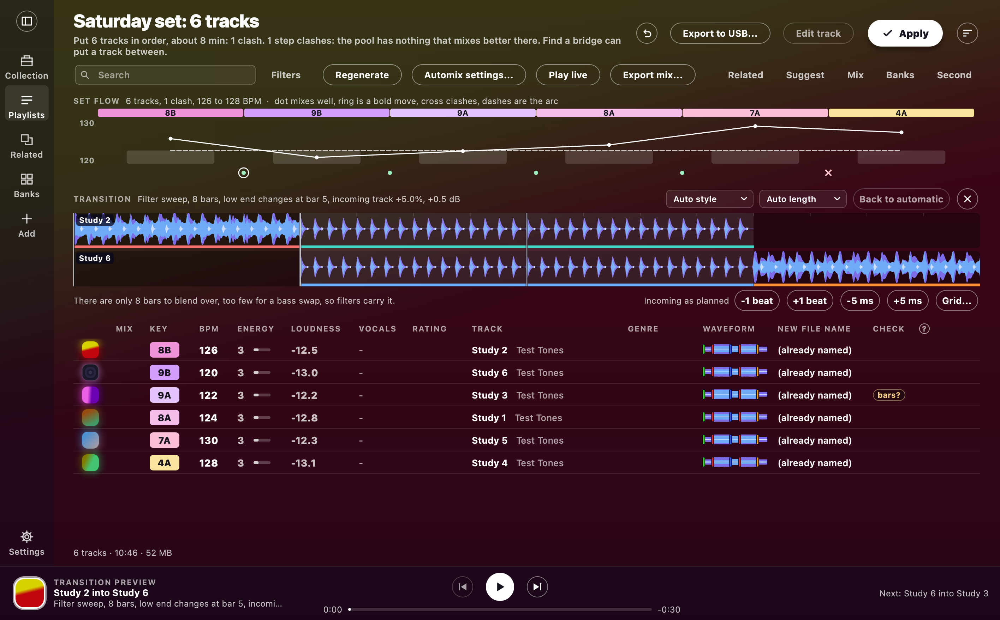

# Export mix

**Export mix...** sits over the table on any list with a set flow, and in the Library menu.
It mixes each step the way [Transition preview](transitions.md) plans it, with your changes.
First it shows you which steps to watch.

**Render mix...** writes the set to one MP3 (320 kbps), FLAC or WAV file.
It runs about 80 times faster than the set plays, with a progress bar and Cancel.

- Each track is brought to the set's median loudness (by up to 6 dB).
  One limiter holds the whole set's peaks.
- After each blend, the incoming track glides back to its own tempo over 16 bars, so the BPM ramp holds.
  Without Rubber Band, it steps back at the blend's end.
- A track that's still blending in doesn't start leaving.
  The next mix waits for the next phrase line, and the export says so.
- A step that can't be planned gets an 8-second crossfade, and the export says why.

**Shift a track a semitone where that lifts a key clash** stays off until you tick it.
It needs Rubber Band.
It shifts as few tracks as it can, a semitone each.
It plans across the whole set, so one fix doesn't cause another clash.
It lists the shifted tracks, and it leaves `key?` tracks alone.
Only the mix file hears the shift.
The preview, your tracks and the cues keep their keys.
DJs rarely do this, and a shifted track goes through Rubber Band from start to finish.
That's why it's opt-in.

**Write rekordbox cues** adds the set to rekordbox's XML as a playlist under the list's name.
Each track gets **Mix in**, **Mix out** and, where the lows swap, **Bass swap** memory cues.
Hot cues stay, and no file is copied.
rekordbox replaces a track's cues on import.
So these mix cues go in next to the cues rekordbox already holds.
For that, choose your rekordbox collection in Settings, as [Cue points](editor.md#cue-points) explains.
A track holds 10 memory cues, and yours stay.
So the status line tells you how many mix cues didn't fit.
Each write replaces the last set's cues and whatever was waiting in the XML.
**Undo last Apply** takes the write back.

**Export to USB...** puts the set on a stick in order, with the same memory cues and no rekordbox needed.
It goes through the usual [Export to USB](usb.md#export-to-usb) window.
Mix cues fill the slots left after the cues each track gets anyway, which are yours plus *Make rekordbox cues*.
The export tells you how many mix cues didn't fit.
Old mix cues from rekordbox come off, and your own cues with the same names stay.
