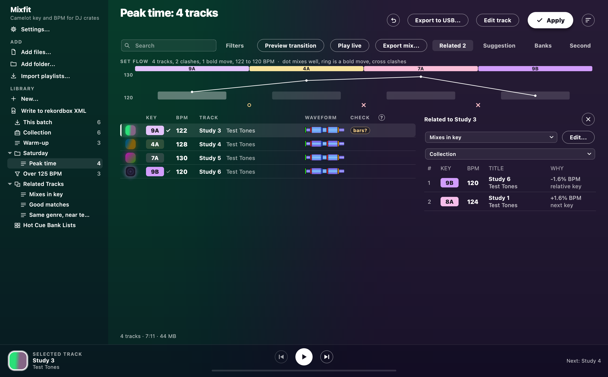
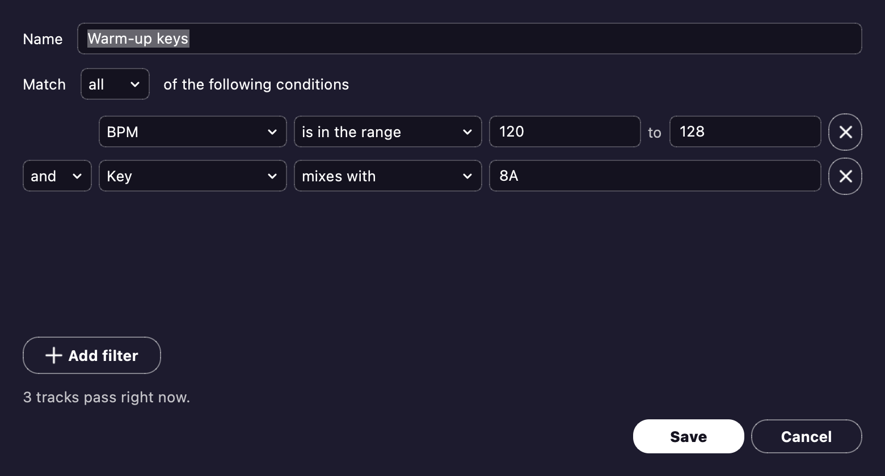

# Library and playlists

Every track you analyse lands in your library.
You can sort your tracks into playlists, folders and matchlists.
You can also rate and tag them, find tracks that go with them, and back it all up.

## The library

Your library is one file, `library.db`.
It lives in the app data folder (`~/Library/Application Support/Mixfit/` or `%APPDATA%\Mixfit\`), never in your music folders.
The **Library** section of the sidebar shows these lists:

- **This batch** holds the tracks you've added since you opened the window, so Apply can tag new tracks without touching the rest.
- **Incoming** holds the tracks your [watch folders](#watch-folders-and-incoming) brought in.
- **Collection** holds every track.
- **Folders and playlists** can nest as deep as you like.
  A matchlist has a funnel by its name.

New tracks go into the batch.
If a playlist is showing, or you dropped the tracks on one, they go into that playlist instead.
Views open straight away, and the covers turn up after.
A track whose file changed, or that needs a newer analysis, gets analysed when its view opens.
Pressing Stop leaves that analysis for later.
If you drop a folder again, Mixfit only analyses the files that changed ([Analysis](analysis.md#how-it-works)).

If `library.db` gets damaged, Mixfit sets it aside as `library.db.damaged-<time>` and starts a fresh one.
The status line tells you when that happens.
Mixfit leaves alone a `library.db` that it can't open, or that a newer version wrote.
In that case your library only lasts until you close the window.
To start clean, delete `library.db`.
That removes your tracks, playlists, ratings and analyses from the library, but no audio file changes.

## Activity

**Activity** is the round button past **Apply**.
You can also open it with Ctrl/Cmd + J, or from the View menu.
It lists the jobs running behind the window: analysis, Apply, USB exports, duplicate scans and folder searches.
Each job has a bar, a count ("6 of 17 tracks") and a **Cancel** button.

- A job that will likely run past 10 seconds tells you roughly how long is left.
- The button's rim fills as the jobs go.
  A dot on it means a finished job has a failure or results for you.
- Finished jobs stay in the list until you press **Clear finished**.
- Tracks waiting for the next batch show as one queued job, and Cancel takes them out of the queue.
- On the table's covers, a clock means the track is queued and a spinner means it's being analysed.
  The card over the table shows the track being analysed right now.

**Cancel never leaves a file half done.**

- Analysis finishes the tracks it's working on.
- Apply stops between files, and **Undo last Apply** takes back what it wrote.
- An export leaves the stick for the next export to finish.
- A scan or a search changes nothing.

Only one job touches your files at a time.
Apply, Undo and the library tools wait for an export, scan or search to end.
New tracks wait for a scan or search to end.
If you quit during Apply or an export, Mixfit asks first, then stops the job cleanly.

## Playlists and folders

| To | Do |
| --- | --- |
| Make one | Use **New...** under the library, or the Library menu (Ctrl/Cmd + N makes a playlist). The new one lands inside the folder you picked, or beside the playlist you picked |
| Rearrange, rename | Drag to rearrange. Press F2 (Return on a Mac) or right-click to rename |
| Delete | Press Delete, and confirm. Deleting a folder deletes everything in it, but the tracks stay in your collection |
| Add tracks | Drag rows or files onto the playlist, or right-click > **Add to playlist** |
| Reorder | Drag rows, or right-click > **Move up** / **Move down** |
| Remove tracks | Press Delete. In a playlist, it asks before removing tracks (or as you choose in [Settings](settings.md)), or Undo brings them back |
| Remove from library | In the **Collection**, Delete takes the track out of the library, after asking. The file stays, and adding it back analyses it again |

A track can only be in a playlist once.
Sorting by a column heading only changes the view.
Once you move a row, though, the order on screen becomes the playlist's order.
No audio file changes.

**Favourites.** You can pin up to eight playlists or matchlists above the library.
Right-click one (or use the Library menu) > **Add to favourites**.

- Click a favourite to open it.
- Drag rows or files onto a favourite to add them, unless it's a matchlist.
- Drag favourites, or use **Move up** / **Move down**, to reorder them.
- Use **Remove from favourites**, or press Delete, to unpin one.

**Add to playlist** lists your favourites first.

## Second list

**Second list** puts another track list beside the table, like rekordbox's Sub Browser or Lexicon's Sidepanel.
Open it from the tabs over the table, or from View > Panel.
Pick which list it shows at the top of the panel.
You can also right-click a list in the library > **Show in the second list**.
The second list reopens on the last list you picked.

- Drag rows between the two lists.
  They land where you let go, in order.
  If the playlist already holds a track you drag in, the track moves to the new spot.
  Only playlists take tracks, and an empty playlist keeps its drop card, which says how to fill it.
- Cmd/Ctrl + Return adds the selected tracks to the end of the other list.
  Each list's right-click menu has the same command, with the other list's name.
- The second list can search (Ctrl/Cmd + F) and sort (Shift-click breaks ties).
  It jumps to a track as you type its name, and you can drag rows to reorder a playlist.
  It plays a track when you click its cover, double-click it or press Space, and Esc stops it.
- Delete in the second list removes a row from the playlist, never a track from your library.
- Tracks that need analysis get analysed when the second list first shows them.

## Matchlists

A matchlist holds every track that passes its filters, like a rekordbox Intelligent Playlist.
It's up to date every time you look at it.

- To make one, choose **New matchlist** from **New...** or the Library menu.
  Choose **Match all** or **any**, and press **Add filter** for more filters.
  The line below the filters counts the matching tracks as you type.
  Create (Save when you edit one) waits until every filter makes sense.
- Under **Match all**, you can set a link to **or**.
  That groups a filter with the one above it, like Lexicon's OR rules.
  For example, `Genre = House` **or** `Genre = Techno`, then `Rating = 5`, gets you five-star house and techno.
- To change a matchlist, right-click it > **Edit filters...**.
  Its tooltip lists the filters.
- Right-click > **Duplicate as playlist** gives you an editable copy of what the matchlist holds right now.
- You can't drag tracks onto a matchlist, reorder it or remove rows from it.
  Change the track or the filters instead.
  Files you drop on a matchlist go to the batch.

**Generate matchlists...** (Library menu) makes one matchlist per genre, artist or label, like Lexicon's Smartlist Generator.
It tells you how many it will make before it starts.
It can skip values that only a few tracks have.
It files the matchlists in **Generated playlists**, with a folder per field.
If you run it again, it only adds the missing ones.

| Filter on | You can use |
| --- | --- |
| Artist, Album, Album Artist, Original Artist, Track Title, Comments, Composer, File Name, Genre, Label, Mix Name, Remixer | `=`, `≠`, contains, does not contain, starts with, ends with |
| Key | the same, and mixes with |
| BPM, Rating, Year, Time, DJ Play Count | `=`, `≠`, `>`, `<`, is in the range |
| Date Added, Date Created, Release Date | `=`, `≠`, `>`, `<`, is in the range, is in the last, is not in the last (days or months) |
| Color | `=`, `≠` |
| My Tag | contains, does not contain, picked from your tags |
| In playlist | `=`, `≠`, picked from your playlists (not matchlists) |

- Case doesn't matter.
- Dates read like `2026-10-31`, and times read like `6:30` or as seconds.
- Key takes `8A` or `Am`.
  "Starts with `8`" finds both modes, and "mixes with `8A`" finds 8A, 8B, 7A and 9A.
- BPM is the BPM the table shows, in your BPM range.
- Rating 0 means unrated.
- Comments skips the key and energy at the front of the comment.
- Genre, label, year and comment come from Track info, or else from the file.
  A value you cleared on purpose counts as blank.
- Date Created is when the file was made (on Linux, when it last changed).
- Release Date is the release date tag, or else the date tag.
  A year on its own counts as 1 January.
- A blank value fails every filter except `≠`, does not contain, and an empty text `=`.
  That empty `=` is how you find tracks with no genre.
- My Tag and In playlist filters follow renames.
  Once their tag or playlist is deleted, they pass nothing.
- DJ Play Count is the Plays column, which comes from imported [play history](#importing-from-rekordbox-apple-music-playlist-files-and-a-players-history).
  A track that was never played has 0.
- A track with an older analysis matches on its old BPM, key and time until it's analysed again.
- Tags are read in the background, so a track can show up in a matchlist a moment after analysis.
  The first start after an update reads every file's tags once.

## Rating, color, Track info and My Tag

Right-click tracks to set their **Rating**, **Color** or **My Tag**.
Each of these gets a sortable column in the Collection and in playlists, alongside genre, label and year.
A narrow window hides these columns, and Rating is the last to go.
The Title tooltip still shows them all.

**Track info** (Ctrl/Cmd + I) also edits genre, label, year and comment.

- With several tracks selected, Track info shows the values they share.
  It saves only what you change, to all of them.
- The values stay in the library.
  Track info doesn't write genre, label or year to the file, but [Smart Fixes](#smart-fixes) do.
  If you empty a box, the field stays blank, even if the file has a value.
- With one track open, **Previous** / **Next** (Ctrl/Cmd + [ / ]) save it and move on to the next track, skipping hidden rows.
  Cancel then drops only the current track's changes.
- Your comment replaces the file's comment the next time you Apply with Write tags on.
  The key stays at the front of the comment.

**My Tag** is for saying what a track is for.
A track can hold several My Tags.
Track info and the right-click menu list them by category.
With several tracks selected, a tag that only some of them hold starts half ticked.
It stays that way unless you change it.
**New tag** adds a tag to the category you picked, and a double-click renames a tag.
**Delete tag** takes the tag off every track, after asking.
Edits to the tags themselves save straight away, even if you press Cancel.
Ticks save when you press Save.

## Smart Fixes

**Smart Fixes...** tidies up messy tags, like Lexicon's.
Open it from the Tracks menu or by right-clicking.
It works on the selected tracks.
From the Tracks menu with one track or none selected, it works on every track showing.
Pick a fix and you see every change, field by field, before anything is written.

| Fix | What it does |
|---|---|
| Remove number prefix | `01. Get Lucky` or `(01) Get Lucky` becomes `Get Lucky`, but `99 Luftballons` stays |
| Fix casing | ALL UPPERCASE or all lowercase becomes Title Case, in the field you pick. Mixed case stays |
| Remove URLs | Takes website links out of the field you pick, or empties a field that holds one |
| Fix encoded characters | `&amp;` becomes `&`, `%20` becomes a space, and `é` becomes `é` |
| Extract remixer | Fills the Remixer tag from a title like `At Night (Purple Disco Machine Extended Remix)`. The title does not change |
| Add (re)mix parentheses | `Green Bottle - Original Mix` becomes `Green Bottle (Original Mix)` |
| Remove garbage characters | Removes repeated spaces, invisible characters, and `] \| -` at the start or end |
| Extract artist from title | `Daft Punk - Touch` becomes artist `Daft Punk` and title `Touch`. You pick the separator and which part is the artist |
| Remove common text | Takes a Camelot key (`10A - Get Lucky`) or `(Original Mix)` out of titles |
| Genre cleanup, Artist cleanup | Lists every genre or artist of the tracks, with counts. Pick the spellings to merge, then type (or double-click) the one they become |

**Apply** writes into the files' tags right away.
Each write is logged, so **Undo last Apply** can take back the latest fix ([Undo](tags.md#undo)).
A title keeps any text that your title format adds, such as the key at the front.
A comment keeps its key.
A genre or comment you set in Track info gets replaced too, and Undo restores it.

## Moving tracks

When Apply or Undo renames a file, the track keeps its playlists, rating and analysis.
If you move a file outside the app, the track shows `missing` under its last name, and Apply skips it.
Add the file's new folder and the track is back in every playlist.
If the file has the same size and modified time, it needs no new analysis.
If it was retagged elsewhere, it's analysed once, and from then on Mixfit knows it by its audio.
A copy of a file, sitting beside the original that's still there, counts as a track of its own.

## Missing files

**Library > Missing files...** lists the tracks whose file is gone.
For each one it shows the last folder and the reason: the file is gone, the folder is gone, or the drive is not connected.
When you plug a drive back in, its tracks come back to life on their own.
To open this window with certain tracks picked, right-click a `missing` row > **Find missing files...**.

- **Search a folder...** searches a folder and its subfolders for the picked tracks, or for all of them if none are picked.
  The search runs in [Activity](#activity).
  The result opens here if you wait, or you can open it later with **Open Missing files** in Activity.
  A file with the same size and modified time is the track, even if it was renamed, and its analysis is kept.
  A file with the same name but a new size or time is taken, and analysed again.
  If several files fit, the search settles by name, then by shared folders, and leaves a tie for you to settle.
  It leaves alone a file that's already analysed as a track of its own.
- **Locate file...** lets you point at the file yourself.
  It then looks beside that file for the other picked tracks.
  If the file you point at is already a track, it asks you first, then merges the two.
- **Remove from library...** takes the tracks out, after asking.
  Their places in playlists and hot cue banks go with them.

Searching and locating only change the library, and no audio file moves.

## Duplicates

**Library > Find duplicates...** runs in [Activity](#activity).
The result opens if you wait, or you can open it later with **Review** in Activity.
If the library changed in the meantime, it scans again.

- **Same audio** groups have identical decoded audio, whatever the tags say.
  These groups start ticked.
- **Same artist and title** groups might be a remaster or an edit, so they start unticked.
- The first file in a group is the best copy.
  It's chosen by bit rate, then by editor grid or cues, then by the playlists and banks holding it, then by what's set on it.
  Pick another file if you'd rather keep that one.

**Merge ticked...** keeps one track per group, and the other tracks leave the library.
The track you keep takes over the others' playlist places, hot cue banks, good matches and My Tags.
It also takes any rating, color or field that it lacks.
A field left blank on purpose stays blank.
Editor grids and cues only carry over between copies of the same audio.
The confirmation question warns you when some of them wouldn't carry over.
No audio file changes.

**Merge and move copies to the Trash...** also moves the other files to the Trash (the Recycle Bin on Windows).

- It lists the files and their size, and warns you if your rekordbox collection holds any of them.
- You have to press **Move to Trash** to go ahead (Return means Cancel).
- A file that can't be moved stays, and so does its track.
- The file you keep never moves, and nor does any second path to it.
- On Windows, files on a stick or a network share stay put.
  Those drives have no Recycle Bin, so moving a file there would delete it for good.

To get a file back, restore it from the Trash and add its folder.

## Watch folders and Incoming

A watch folder brings new tracks in on its own, as in Lexicon.
To turn it on, tick **Watch for new tracks** in Settings (it's off by default).
If you haven't chosen a folder, it watches `Music/Mixfit/Watch Folder` in your home folder.
**Add watch folder...** watches another folder, subfolders included.
**Remove watch folder...** stops watching a folder.

When you drop a new audio file in a watch folder, it joins the library and waits in **Incoming**.
It gets analysed whatever view is showing.
A file only comes in once it stops changing, so a copy or download in progress waits.
Mixfit skips files already in the library, playlist files, pictures and hidden files.
Anything added while the app was closed comes in at the next launch.

In **Incoming**, **Selected done** clears a track from the list and selects the next one.
The cleared track stays in your library.
**All done** clears the whole list.
Delete takes a track out of the library, after asking, but the file stays.

## Backup and restore

**Library > Back up library...** saves one zip file.
It holds `library.db`, your settings, the cue history and cue file, the covers Mixfit found, the waveforms and your editor work.
Mixfit reads the backup back before keeping it, so you know it opens.
Your audio files aren't in it, so back those up too.
The Undo logs stay out of it, since they describe your files as they are now.

**Library > Restore library...** replaces all of that, after asking, and reopens the window on the restored library.
First it saves your current library as `before-restore-<time>.zip` in the app data folder, so you can go back.
Mixfit refuses a damaged backup, a backup from a newer version, or one that isn't Mixfit's, and nothing changes.
No audio file changes, and **Undo last Apply** still works.
A backup from another Mac or PC restores too.
Its tracks show as missing until **Search a folder...** finds them, and their playlists, ratings and analyses are kept.

## Importing from rekordbox, Apple Music, playlist files and a player's history

**Import playlists...** is in the sidebar and the Tracks menu.
It takes one file or several, and the tree fills in the background.

| Choose | From | What comes |
| --- | --- | --- |
| A rekordbox XML | File > Export Collection in xml format, with *Export BeatGrid information* ticked under Preferences > Advanced | Every track, the playlist tree, hot cues, memory cues, loops, beat grids, and each track's rating, color, genre, label, year and comment |
| An Apple Music XML | File > Library > Export Library | The playlists and folders you made, the tracks in them, and each track's rating, genre, year and comment |
| M3U, M3U8 or PLS | Any app that writes them | One playlist, named after the file, in its order |
| TXT | rekordbox's File > Export a Playlist in TXT format | One playlist, named after the file, in its order |
| A USB stick's `PIONEER/rekordbox/export.pdb` | The history a CDJ or XDJ writes to a rekordbox stick as you play | Each set, in the order played |

No audio file changes, and Mixfit only reads rekordbox's XML.
Imported tracks get analysed when their view opens, so open a playlist to get its keys and BPMs.
A track needs that analysis before it can go on a stick or in the XML.

**Cues.** Imported cues and grids become the track's own.

- The track's row says `keeps its own`, and Apply leaves those cues alone.
- **Export to USB** and **Write to rekordbox XML** carry them, even with no collection chosen.
- rekordbox's automatic memory cue on the first beat doesn't count.
  A track with only that cue gets Mixfit's cues.
- If you choose a collection that has cues on a track, those cues win, since they're what rekordbox holds now.

**Importing again** is safe, and importing the same file twice changes nothing.

- Folders and playlists merge into ones with the same name.
- A playlist only gains its missing tracks, at its end.
- Nothing gets removed.
- An import only fills empty rating, color, genre, label, year and comment fields.
  Cues, though, come from the newest import that has any.

**Play history.** rekordbox's `HISTORY yyyy-mm-dd` playlists and a stick's player history go into **History**.
History has a folder per year, and each set is named `HISTORY yyyy-mm-dd`.

- A player keeps no date, so a set from a stick only gets a date if its name holds one.
  Otherwise the set keeps the player's name for it (`HISTORY 001`), in a folder named after the stick.
- A track from a stick counts as your library's copy when exactly one library track has its file name and size.
  Otherwise it's the file on the stick.
- Each set adds to the Plays column.
  A track played twice in a set counts twice, but shows once.
- A set already in History adds nothing when you import it again.
- Plays never drop below the Play Count from an imported rekordbox collection.

**What stays out.**

- Files that aren't found come in as `missing`, under their names.
  An XML track that gave its size is found again when you add its new folder and the name and size match.
  [Missing files](#missing-files) can find any of them by name.
- Streams, web addresses and videos stay out.
  On a Mac, Windows paths in a playlist file stay out too.
  The sidebar says how many tracks stayed out.
- A TXT file without a Location column matches its rows by artist and title to tracks already in your library.
  Rows that don't match stay out.
- Repeats in a source are dropped, since a track can only be in a playlist once.
- Apple Music's whole library and its built-in lists stay out, since albums and podcasts rarely make a crate.
  If you want those tracks, add them the usual way.
- A smart playlist comes in as the tracks it holds today.
- Memory cue colors and My Tag don't come in, because they aren't in rekordbox's XML.

## Related tracks and hot cue banks

The tabs over the right side of the table open a panel.
The panel has four tabs: Related tracks, [Track suggestion](#track-suggestion), Hot cue banks and the [Second list](#second-list).
Each tab works on the track selected in it.
**Related tracks 12** counts the matches, even with the panel closed.
**Hot cue banks 3/8** counts the filled banks in the chosen list.
Press the tab again, or the X, to close the panel.

### Related tracks

**Related tracks** lists tracks that go with the selected track, best first, with the reason why.
It searches the Collection, or the folder or playlist you choose beside it.
Double-click a result, or press Return on it, and the table shows that track.
The panel then follows, so you can walk from track to track.
Drag results onto a playlist, or right-click > **Add to playlist**.

The **condition** decides what counts as related.
Three conditions come built in: **Mixes in key**, **Good matches** and **Same genre, near tempo**.
To make a new condition or folder, right-click **Related Tracks** in the tree.
To edit, copy, rename or delete a condition, right-click it.
As in rekordbox, a condition matches all or any of its items:

| Item | What it asks |
| --- | --- |
| BPM | Within a percentage. Half and double time count as the same tempo, so 87 sits beside 174 |
| Key | rekordbox's own ranges, below |
| Registered as a good match | Only the pairs you registered |
| Same genre, label, artist, remixer, composer, color or file format | The same as the selected track. Case does not count, and a blank never matches a blank |
| Shares a My Tag | At least one of its My Tags. More in common ranks higher |
| Same comment | Your comment, without the key and energy in front |
| Rating | At least so many stars |
| Year | Within so many years |
| Energy | Within so many levels of Mixfit's estimate |
| Added | Came into the library within so many days of it |
| Played in a set | Within so many tracks of it in a set of your [imported play history](#importing-from-rekordbox-apple-music-playlist-files-and-a-players-history): 1 is right before or after |
| Mashup | One track's acapella fits the other's instrumental, by the rules of [Mashups](#mashups). rekordbox has no such item |

The key ranges are the ones from rekordbox's Traffic Light.
For a track in 2A, they are:

| Range | Keys |
| --- | --- |
| Same key | 2A |
| Same or relative key | 2A, 2B |
| Those, and a step round the wheel | 2A, 2B, 1A, 3A |
| Those, and the same step in the other mode | 2A, 2B, 1A, 3A, 1B, 3B |

Mixfit reads genre, label, year, remixer and composer from the tags the first time a search needs them.
It keeps them until the file changes.
So the first search on a big collection takes a while, in the background.
The results leave out tracks not analysed yet, missing files, and copies of the selected track's audio.

**Good matches** are the pairs you know are gold dust, and you pick them yourself.
To make one, select two tracks and right-click > **Mark as a good match**.
You can also right-click a result to pair it with the selected track.
A pair has no order, and it survives renames and moves.
A good match always ranks first, but it only shows when it meets the condition.
That's why the **Good matches** condition lists them all.
Taking a track out of the library drops its good matches, with a warning first.

In Mixfit, rekordbox's Traffic Light is the table's Key column ([Harmonic match](window.md#the-table)).
It marks keys against the track playing from the list, or else the selected track, rather than a deck's track.

### Hot cue banks

**Hot cue banks** gather cues from different tracks into eight banks, A to H.
The banks belong to a **Hot Cue Bank List**.
To make a list, use **New list**, or right-click **Hot Cue Bank Lists** in the tree.
Folders in the tree can order lists too.

- Select a track and click one of its cues to save the cue in the picked bank.
  The next empty bank then gets picked.
  To replace a full bank, pick it first.
- Click a full bank to play its cue through the list's player, as Space would.
  Click it again to pause.
- In the [track editor](editor.md#track-editor), the bank button beside Click and Snap saves the playhead into a bank of this list.
  With Snap to beats, it saves the spot on the grid.
  The track itself gains no cue.
- To empty a bank, use its X, press Delete, or right-click it.
  The right-click menu also shows the bank's track in the table.
- A list can have a JPEG or PNG picture, which you set from its right-click menu in the tree.
- A bank keeps its own copy of the cue, as in rekordbox, so later cue changes leave the bank as you saved it.
- Taking a track out of the library empties its banks, with a warning first.

**Banks don't reach a player yet**, because neither rekordbox's XML nor the stick writer has a place for them.
For now, an export or **Write to rekordbox XML** puts each list's tracks in a `Hot Cue Bank Lists` folder.
Each list becomes a playlist in bank order, so the tracks and cues still reach the stick.

## Track suggestion

**Track suggestion** lists tracks to play next, best first, like rekordbox's Track Suggestion.
It searches the Collection, or the folder or playlist you choose beside it.
Its results work like the results in Related tracks (double-click, drag, right-click).

| Recommend by | What comes first |
| --- | --- |
| Collection Radar | Tracks that sound like it |
| Era | Tracks released within 5 years of it, the closest first |
| Mood | Tracks within 2 levels of its energy, scored by how close it is, the same mode (minor or major) and as much voice |
| Association | Tracks that share an artist, remixer, composer, album artist, original artist, label or album with it |
| Mashup | Tracks whose acapella fits its instrumental, or whose instrumental its acapella fits (see [Mashups](#mashups)) |

Era, Mood, Association and Mashup break ties by how alike the tracks sound.
Era reads the library's year, or else the file's year or date tag.
Association reads the file's credits, in the background.
**Filters...** narrows Collection Radar by BPM range, key range, or vocals, like rekordbox's setting window.
Streaming Radar needs a streaming service, so it isn't here.

### Mashups

It takes two to make a mashup, so **Mashup** suggests pairs where one track's acapella can ride over the other's instrumental, and its Why column says which way round: `its acapella over this`, `this acapella over it`, or `either acapella over the other`.
It weighs three things the analysis already keeps, so it needs no stems to find a pair:

- **Key.** Both keys sure (neither marked `key?`) and at most a step round the wheel apart: the same key, its relative, or the next key in the same mode. Under a vocal a key clash is heard first, so the other mode's next key is left out.
- **Tempo.** Both tempos sure (neither marked `bpm?`), and the acapella stretched to the instrumental's tempo by 6% at most, in the same time or in half or double time. The Why column gives the stretch, such as `vocal stretched -3.1%`. The vocal is taken to keep its key as it stretches, as a key lock or Automix's Rubber Band keeps it.
- **Vocal phrase length.** It measures how many bars each sung phrase of the acapella runs, and checks it against the instrumental's phrases. A vocal phrase fits when it starts and ends on the instrumental's phrase lines, or loops evenly inside one of its phrases. A 12-bar verse over a track built in 8-bar phrases fits neither way. At least half the vocal has to fit, and the Why column says how much did.

The best pairs come first: closer keys, less stretch and more of the vocal on the phrase lines.
Every bound above is chosen from what DJs do, not set on pairs a person marked, and no suggested mashup has been judged by ear yet, so take a suggestion as a lead to listen to.
To hear one, [export](automix.md#acapella-and-instrumental-files) the acapella and the instrumental.

### How Collection Radar hears a track

Collection Radar compares how tracks sound.
It uses what the [vocal model](analysis.md#vocals) already hears during analysis, so there's nothing extra to download and analysis barely slows down.
Tracks analysed by an older version have no radar.
So each of them is analysed once more, the first time you add it after updating.
Treat Collection Radar as a hint.
On the test tracks, it finds the same genre a little more often than rekordbox's radar does.
It shares about 1 in 3 of the top 5 tracks that rekordbox's radar picks.
