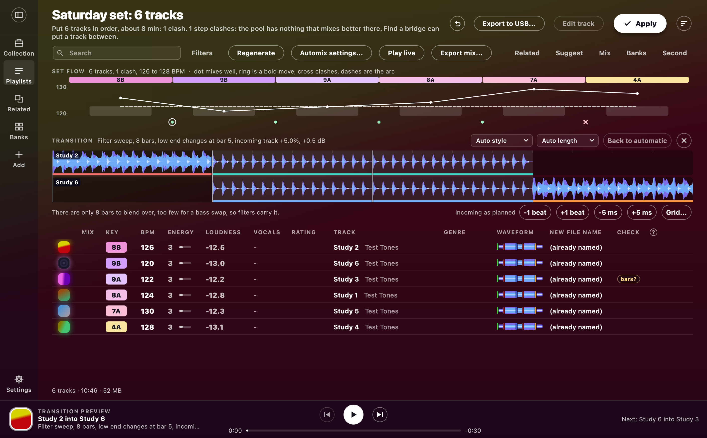

# Play live

**Play live** sits over the table on any list with a set flow.
It plays the set as one continuous mix, from the selected track or the top, with nothing rendered first.
Each mix goes the way [Transition preview](transitions.md) plans it.
Play live also adds what [Export mix](export-mix.md) adds: median loudness, the tempo glide, and a crossfade where a step can't be planned.

The [player bar](window.md#the-player-bar) shows what's playing, what's next, how soon and in what style.
It marks the next mix on its bar, and it stays on the set while you browse.
The set flow rings the track that's playing and the step being mixed.
The table shows a pause sign on the playing track's cover.

- **Click or drag** on the player bar to jump around the track.
  Click or drag on the set flow to jump anywhere in the set.
  A track's column runs from the middle of the mix in to the middle of the mix out, so dragging over a step runs through the mix.
  You can also Tab to the player bar and jump 10 seconds with Left and Right.
- **Next** mixes into the next track at the next phrase line, over 8 bars.
  Press it again to go at the next bar.
  During a mix, **Next** finishes the mix in a bar.
  While a track is still gliding back to its tempo, **Next** echoes out.
  An echo-out or hard cut can't be rushed, and the status line says so.
- **Reorder** the set by dragging or sorting, or add or remove tracks.
  You can even remove the playing track, which plays on until its mix.
  The set picks up from the next mix not yet started.
- **Change a mix** while the set plays, and the set follows at once.
  That goes for a style or length you set in the [transition preview](transitions.md), a grid you fix in the editor or the preview, a new [BPM range](analysis.md#how-it-works) and a new analysis.
  Every mix not yet started plays the way the table, the set flow and the preview show it.
- **Apply, Undo and Smart Fixes** stop the set first when they would change one of its tracks, and they ask before they do.
  A renamed track would drop out of the set, and new tags can make a playing track jump.
- **Pause** holds the set, and so does playing anything else or opening the editor.
  **Stop** ends the set.
- A track that can't be read gets skipped, and the status line says so.
- **Stems**: a row over the player bar has **Vocals**, **Drums**, **Bass** and **Rest** for the playing track and the next one, once their [stems](stems.md) are ready.
  Click one to mute it, and click again to bring it back.
  Shift-click or right-click solos it, and the same again brings the others back.
  Ctrl+1 to Ctrl+4 (⌘ on a Mac) press the playing track's buttons, and Ctrl+5 to Ctrl+8 the next track's.
  What you set stays with the track, so you can mute the next track's vocal before it comes in.
  A muted stem is struck through, and a soloed one is filled.
  A track whose stems aren't ready, or that started before they were, has its buttons off and says why.
  A stems move plays its own stems, so the buttons wait until it's done.
  You hear a press within about 46 ms, and each stem fades over 23 ms, so it never clicks.

Key shifts are only for rendered mixes, so tracks play live at their own pitch.
Play live plays through the [Audio output](settings.md#audio-output) in Settings.
If you change the output, Play live follows it without losing its place.

## Under the hood

The live sound runs in its own process, so nothing the window does can make it stutter.
