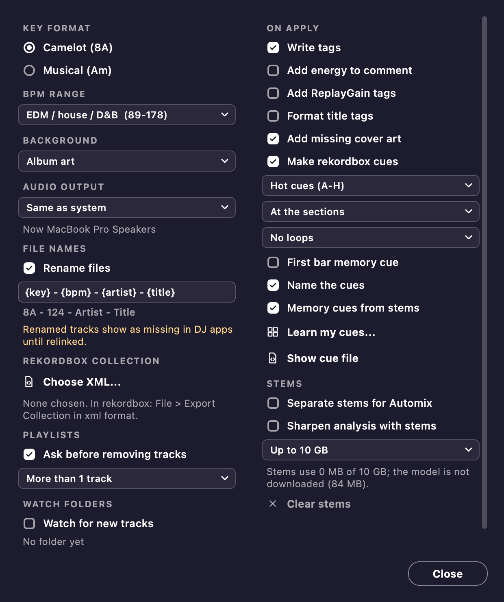

# Settings

You can open Settings from the foot of the sidebar or its rail, from the Edit menu (the app menu on a Mac), or with Ctrl or Cmd + comma.
Changes take effect right here, right now.
Mixfit keeps them in `settings.json` in the [app data folder](#where-your-data-lives).

| Setting | What it does | More |
| --- | --- | --- |
| Key format | Shows keys as Camelot (8A) or musical (Am), everywhere keys show | [Analysis](analysis.md#how-it-works) |
| BPM range | Picks EDM / house / D&B (89-178), Hip-hop / downtempo (70-140), or no half and double time correction | [Analysis](analysis.md#how-it-works) |
| Background | Picks Album art, Dark or Light | [Background](#background) |
| Audio output | Picks where every sound plays | [Audio output](#audio-output) |
| On Apply: Write tags | Writes the key, BPM, artist and title into the files | [What Apply writes](tags.md#what-apply-writes) |
| Add energy to comment | Puts the energy level after the key in the comment | [Energy level](analysis.md#energy-level) |
| Add ReplayGain tags | Writes the loudness, for players that level tracks | [ReplayGain tags](tags.md#replaygain-tags) |
| Format title tags | Gives the title tag a format of its own | [File name and title formats](tags.md#file-name-and-title-formats) |
| Add missing cover art | Looks up a cover online for tracks with none | [Cover art](tags.md#cover-art) |
| Make rekordbox cues | Makes cue points for rekordbox to import. It has its own options, plus **Learn my cues...** and **Show cue file** | [Cue points](editor.md#cue-points) |
| File names: Rename files | Renames files to the format in the box. **Default file name** goes back to the default format | [File name and title formats](tags.md#file-name-and-title-formats) |
| rekordbox collection | **Choose XML...** reads your collection export, **Forget** stops using it, and **Cue history...** opens its history | [Renaming and your DJ library](tags.md#renaming-and-your-dj-library), [Cue history](editor.md#cue-history) |
| Watch folders | Has **Watch for new tracks**, **Add watch folder...** and **Remove watch folder...** | [Watch folders and Incoming](library.md#watch-folders-and-incoming) |
| Playlists: Ask before removing tracks | Turns confirmation before removing tracks on or off, and picks More than 1 track or Every track | [Playlists and folders](library.md#playlists-and-folders) |
| Stems | Has **Separate stems for Automix**, **Sharpen analysis with stems**, the room stems may take, and **Clear stems** | [Stems](#stems) |

**Check for updates at launch** is in the Help menu (the app menu on a Mac).
[Updates](updates.md) explains it.

## Stems

Both stems settings use one model, the weights of HTDemucs, downloaded once after you agree (84 MB, kept only if their SHA-256 matches the one pinned).
**Separate stems for Automix** separates the stems a set needs for Automix's [stems moves](automix.md#stems).
**Sharpen analysis with stems** separates every analysed track whole and reads its bar 1, key and vocal parts again from its stems; see [Sharpened by stems](analysis.md#sharpened-by-stems).
The room setting and **Clear stems** are for the stems Automix keeps; the analysis keeps only measures, which go with the track's other analysis files.

## Background

**Background** picks Album art, Dark or Light.
Album art is the default, and it shows the selected track's cover, blurred, or the cover of the track that's analysing.
Dark and Light don't change with the track you select.
The editor's waveform always sits on a dark background.
Some system settings give you a solid background instead of the cover:

- On macOS, Reduce Transparency or Increase Contrast.
- On Windows, Transparency effects turned off, or a contrast theme.

Increase Contrast and contrast themes also sharpen text, lines and edges.

## Audio output

**Audio output** picks where every sound plays.
That covers the list, the [track editor](editor.md#track-editor), [Preview transition](automix.md#transition-preview) and [Play live](automix.md#play-live).

- **Same as system** (the default) follows your computer, and the line under it names the device.
  If you connect AirPods or headphones mid-track, the sound fades over in under a second and carries on where it was.
  If a Bluetooth device flickers while it connects, Mixfit waits for it to settle, so the sound only moves once.
- **Pick a device by name** to always play there.
  While that device is unplugged, it stays in the list marked (not connected), and sound plays on the system's output.
  Settings and the status line both tell you about it.

If there's no output at all, the status line says so, and the playhead keeps running.

## Where your data lives

Mixfit keeps the library, settings, logs, waveforms, covers and cue file in the app data folder, never in your music folders:

- macOS: `~/Library/Application Support/Mixfit/`
- Windows: `%APPDATA%\Mixfit\`

[Backup and restore](library.md#backup-and-restore) saves all of it in one zip.
