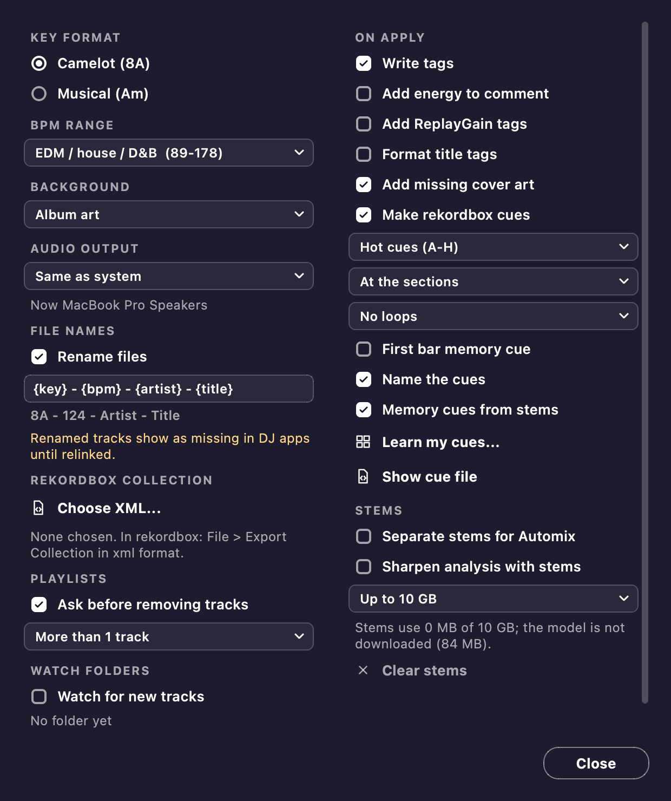

# Stems

Stems are a track's vocal, drums and bass, separated from it once.
The fourth stem is everything else: the track minus those three, so the four always add up to the track.
Stems power Vocal over, the four stems styles and a vocal held out of a blend, all [chosen with the style](transitions.md#the-style).
They also give Play live its [stem buttons](play-live.md), and the editor its [cues from stems](editor.md#cues-from-stems).

Vocal over lays one track's vocal over the other's instrumental, either way round.

- **Carried out:** the outgoing track stops on a phrase line in or after its last main section.
  Its vocal carries on over the incoming intro.
  The intro's own vocal stays muted.
- **Carried in:** the incoming vocal arrives early over the outgoing instrumental.
  The incoming track's own instrumental drops in on its first main section.

Vocal over needs all of these:

- Both keys are sure, and a safe move apart.
- Neither track is `bars?`.
- There's a voice through the bars the vocal rides.
- The vocal is stretched 2% at most.
- The separated vocal has no kick standing out.

If any of that's missing, another style goes, and the note says why, like `A Vocal over would help here, but stems still being prepared.`
A solo vocal shows separation mistakes worst, so this is the riskiest move Automix makes.
Nobody has judged it by ear yet.

The stems styles swap a track's stems one at a time, at the blend's halfway point.
Automix reads whether a track has a steady kick from its separated drums.
Sometimes the separator leaves part of a bassline in the rest of the track.
That part crosses the way an EQ bass swap would, so a stems bass swap never sounds worse than an EQ one.
Each stems style is a rule taken from what DJs and stems research say, and none has been judged by ear yet.
So pick another style if your ears say so.

Every stems move sounds the same in the preview, in [Export mix](export-mix.md) and in [Play live](play-live.md).
In Play live, a skip lets it play out like an echo-out.

Turn on **Separate stems for Automix** in [Settings](settings.md).
The first time, Mixfit asks before downloading the [HTDemucs](https://github.com/adefossez/demucs) weights (84 MB).
Their author says "The model weights are not covered by the MIT license, and are provided only for scientific purposes" ([the statement](https://github.com/facebookresearch/demucs/issues/327)).
The Demucs README adds that "the license of the weights is not clear" because the weights learnt from research-only data.
So the app doesn't ship them.

- Separation runs as **Separate stems** in Activity, at the lowest priority, with Pause and Cancel.
  It waits while an analysis runs.
- It only does the playlist on show, but the whole of each track, so you can mute a stem anywhere in it live.
  On a busy machine, a set of twenty five-minute tracks takes about 80 minutes.
  A track cut off by quitting starts over.
- A track's stems take about 16 MB per separated minute in the app data folder's `stems`, never next to your music.
  Backups leave them out.
  Settings shows their space and caps it, 10 GB unless you choose, removing the least recently used first.
  **Clear stems** deletes them, but the cues found in them stay.

## Acapella and instrumental files

Right-click tracks in the table and choose **Export acapella...** or **Export instrumental...** to save either as a file of its own, for edits or a [mashup](library.md#mashups).
For one track you pick the file, which starts beside the track as `<its name> (Acapella).flac` or `(Instrumental).wav`; for several you pick a folder, and a name already there gets a number rather than being replaced.
Nothing is ever written over the track itself.
This works whether or not **Separate stems for Automix** is on; the first time, Mixfit asks before it downloads the model, as above.
The whole track is separated, in the same **Separate stems** job and ahead of what Vocal over is waiting for, which takes about a minute a track; the status line says where each file went.

The acapella is the separated vocal, for when a voice is better off alone.
The instrumental is the track with that vocal taken out, so play the two together and you get the original back, however well the separation went.
The instrumental is a 32-bit float WAV because taking the vocal out can push it past full scale, and a normal WAV would clip there; a DAW opens it, though some players don't.
Both start where the track's grid and cues do, so they line up with the track and with each other.
Separation isn't perfect: a little of the beat can stay in the acapella and a little voice in the instrumental.
