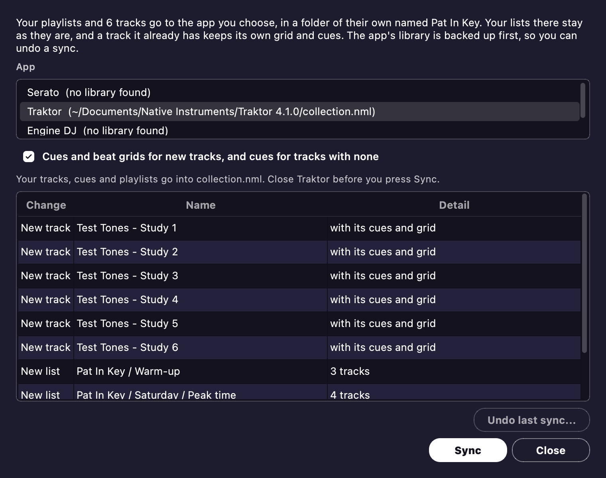

# Sync to rekordbox and other apps

You can prep your library here and play it in another app.
Your playlists go to rekordbox through its XML file, and straight into Serato, Traktor or Engine DJ.
If you want a CDJ or XDJ stick without rekordbox in the middle, see [Export to USB](usb.md#export-to-usb).

## rekordbox XML

**Write to rekordbox XML** puts your playlist tree in `rekordbox-cues.xml`, which is the file rekordbox already imports from.
Each track goes in with its rating, color, genre, label, year, comment and My Tags.
Whenever that file exists, Apply keeps it up to date too.
In rekordbox, refresh **rekordbox xml**, then right-click a playlist to import it.
[Cue points](editor.md#cue-points) shows how to set rekordbox up for this.

- The XML can't carry filters, so a matchlist goes in as a plain playlist of the tracks it holds right now.
  A matchlist goes onto a stick the same way.
- A track in your chosen rekordbox collection keeps its attributes and grid.
  It only takes the fields you set here.
- If you haven't chosen a collection, a track that's only in a playlist goes in with no cues.
  That way an import can't overwrite cues that Mixfit can't see.
- Missing tracks and unanalysed tracks stay out, and the status line tells you how many.
- A `--cues` run on the command line replaces the whole file, playlists included.
  The file stays that way until the window writes it again.

**My Tags go in as comment text**, as in `closer /* Vocal / Peak Time */`.
That's where rekordbox's own Add "My Tag" to the "Comments" setting puts them.
A stick's comment carries the same text, and [Export to USB](usb.md#export-to-usb) puts them on as real My Tags too.
rekordbox's XML has no My Tag field.
So rekordbox's My Tag column stays empty, and a player's tag filter won't list these tags.
The comment in your audio file stays your own.
Say you take a track's last tag off, and your chosen collection already holds a comment for that track.
Mixfit leaves that comment as it is, so clear it in rekordbox yourself.

## Sync to Serato, Traktor and Engine

**Sync to Serato, Traktor or Engine...** in the Tracks menu sends your playlists to another app's library.
If you don't have playlists, it sends the table's tracks as one list.
This feature is new, and no copy of Serato, Traktor or Engine DJ has opened a synced library yet.
So start with a small playlist.

| | Where | What goes | What stays |
| --- | --- | --- | --- |
| Traktor | `collection.nml` in the newest Traktor folder | New tracks with tags, rating, key, BPM, grid and cues, and playlists | Every track already there, with its grid and tags. A track with no cues of its own gets ours. |
| Serato | `_Serato_` in your Music folder, and on each drive that has one | New tracks and crates, taken in at Serato's next start. With the option ticked, cues too, written into the music files (MP3, AIFF, WAV and M4A only) | Your crates, tracks and their grids. Serato makes its own grid. |
| Engine DJ | `Engine Library` in your Music folder, Engine DJ 2.2 to 5.0 | New tracks with tags, rating, key, grid, cues, loops and an overview waveform, and playlists | Every track already there, with its grid and tags. A track with no cues gets ours. A newer library is refused. |

A track on another drive stays out of Engine.
It also stays out of Serato, unless that drive has a `_Serato_` folder.
The preview tells you which tracks stay out.

- **You see it first.** When you pick an app, every change gets listed.
  Nothing is written until you press **Sync**.
- **Close the app first.** All three apps write their library back when they close.
  So Mixfit refuses to sync while the app is open.
- **Your lists stay yours.** Everything goes in a folder named Mixfit, and a list you add to that folder yourself stays put.
  Syncing again only changes the lists that match yours here.
  Deleting a playlist here removes nothing from the app.
- **Backed up first.** Before a sync, every file it can touch gets copied to `sync-backups` in the app data folder.
  Mixfit keeps the backups of the last five syncs for each app.
- **A failed or cancelled sync leaves no trace.** The backed-up copies go back in place.
- **Undo last sync...** in the dialog puts the app's library back the way it was.
  If the app has changed its library since the sync, you're told first, because undoing also loses those changes.
  The library as it stands then gets saved beside the backup.
  Serato rewrites its files every time it closes, so expect that warning with Serato.
- **Music files only change for Serato's cues.** Even then, they change only if the audio comes out the same.
  Undo takes those cue tags off again, unless Serato has changed them since.

Mixfit hasn't measured cue timing in these apps itself.
For each app, it follows what other converters found.
