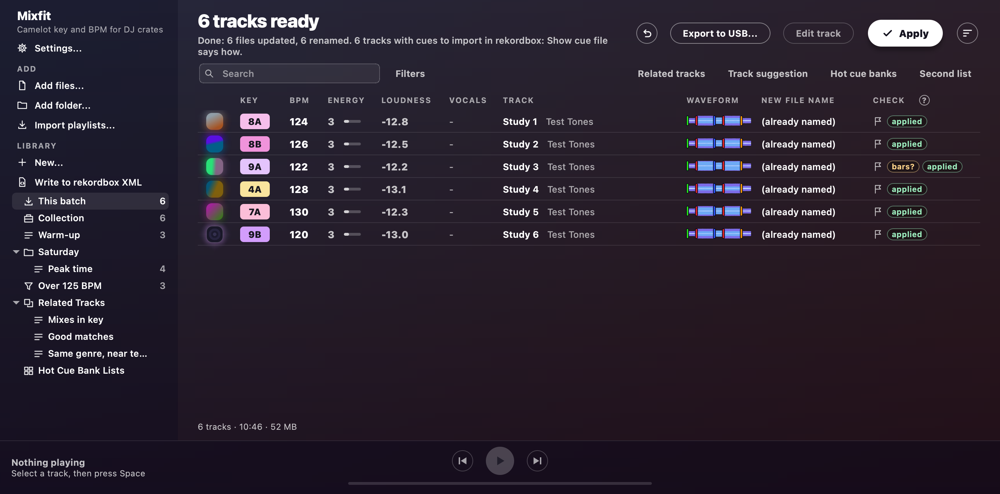

# Tags, names and Apply

Apply writes what the analysis found into your files.
It puts the key, BPM, artist and title in the tags, adds the key at the front of the comment, and gives the file a tidy name.
Undo takes all of it back.



## What Apply writes

Mixfit reads MP3, WAV, AIFF, FLAC, M4A/AAC, OGG/Opus and WMA files.
It writes the key, BPM, artist and title where rekordbox, Serato, Traktor and Mixxx look for them.
In tags and file names, the BPM is a whole number.
Only the beat grid in the rekordbox XML keeps the decimals ([Cue points](editor.md#cue-points)).
rekordbox reads no WAV tags, though, so see [Keys in rekordbox](#keys-in-rekordbox).

**The key goes at the front of the comment**, in your Key format, so `promo copy` becomes `8A - promo copy`.
Your own text stays.
If the comment already starts with an old key, Apply replaces that key instead of adding a second one, whichever tool wrote it.
A Mixed In Key energy level also stays, unless you tick *Add energy to comment*.
So `10A - Energy 6 - promo copy` becomes `8A - Energy 6 - promo copy` ([Energy level](analysis.md#energy-level)).

On FLAC, Ogg and Opus files, Mixed In Key puts its key in the description instead of the comment.
If a description holds nothing but an old key, Apply clears it and moves any energy level to the comment.
Apply leaves any other text in the description alone, and Undo puts a cleared description back.
The Comment column and `--dry-run` show each new comment before Apply writes it.
When Apply will clear a description, they add `(clears DESCRIPTION)`, and the row says `cleaned`.

### Old prefixes

An earlier rename may have left a key and BPM prefix on the title, like `8A - 123.6 - ...`.
Apply takes that prefix off, so running it again never stacks prefixes or keeps decimals.
Apply also removes stacked prefixes (`7A - 174 - 7A - 87 - ...`) in full.
It does the same for a prefix that an older version split across the artist and title.

### Key and energy text from other tools

Other tools sometimes stick key and energy text at the start or end of a title, artist or file name.
Apply takes that text off too: `10A - Title`, `Title - 10A`, `10A - Energy 7 - Title`, `Artist - Title - Cm - 124`.
Apply only removes text that's set apart by ` - `, and only when a name is left afterwards.
So `128`, `8AM Sunrise` and the artist `Energy 52` stay put.
A musical key such as `Cm` only counts when it's next to a tempo or energy level.
The row says `cleaned`, and the table shows the result before you press Apply.
Undo brings the old text back.

## When Apply cannot write a file

When Apply can't write a file, it carries on with the rest.
The row shows the reason in red in the Check column, and the New file name column shows the fix.
To read the full message, hover over the badge or select the row.

| Reason | Cause |
| --- | --- |
| `read-only` | The file's Read-only attribute or macOS Locked flag, its permissions, a read-only folder for a rename, or a read-only drive |
| `in use` | Another program has it open |
| `cloud sync` | OneDrive or another sync app holds it, or it is online-only |
| `access denied` | Another account owns it, or Windows Controlled folder access protects the folder |
| `missing` | Moved, deleted, or its drive unplugged |
| `disk full` | No room left on the drive |

The summary counts these files, like `2 not written: 1 read-only, 1 in use`.
The command line prints the reason for each file.
Mixfit won't clear a read-only flag or change permissions for you.
Fix the file yourself, then Apply again.

## Renaming and your DJ library

> rekordbox, Serato and Traktor find tracks by their path.
> So if you rename a track they already know, it shows as missing until you relink it.
> Rename new tracks before you import them.
> For tracks your DJ app already knows, only write tags, or use a rekordbox collection export.

A rekordbox collection export protects the tracks rekordbox knows.
To make one, choose File > Export Collection in xml format in rekordbox.
Then pick that file with **Choose XML...** under *rekordbox collection* in [Settings](settings.md), or pass `--rekordbox-xml export.xml`.
The tracks in that collection keep their names under any format, and they still get their tags.
Their rows read `(keeps its name: in your rekordbox collection)`.
Mixfit only reads the XML, and it never touches rekordbox's database.
Mixfit reads the export again each time it starts, so export again after you add tracks to rekordbox.
**Forget** stops using the export.

## File name and title formats

A format is text with tokens in it: `{key}`, `{bpm}`, `{energy}`, `{artist}` and `{title}`.
`{key}` follows your Key format (`8A` or `Am`).
`{energy}` is just the [energy](analysis.md#energy-level) number, so write `Energy {energy}` if you want a label.
Set the file name format under *Rename files* in Settings.
An example shows under the box, and the New file name column updates as you type.
**Default file name** takes you back to `{key} - {bpm} - {artist} - {title}`.

| Format | Result |
| --- | --- |
| `{key} - {bpm} - {artist} - {title}` | `8A - 124 - Artist - Title.mp3` |
| `{artist} - {title} [{key}]` | `Artist - Title [8A].mp3` |
| `{bpm} {key} {title}` | `124 8A Title.mp3` |
| `{key}_{artist}_{title}` | `8A_Artist_Title.mp3` |
| `{key} - Energy {energy} - {title}` | `8A - Energy 6 - Title.mp3` |

If a track has no artist or energy, the name just drops that token and its punctuation (`8A - 124 - Title.mp3`).
Your own text around `{energy}` stays, though.
Mixfit replaces any characters in an artist or title that Windows or exFAT refuse.

**What a format needs.**
A format has to have `{title}`, and a space or dash between tokens.
A file name format also can't hold ``< > : " / \ | ? *`` or start with a dot.
If a format is broken, Settings says why in red.
The table keeps the last good format, and Apply waits until you fix the broken one.

**Title tags.**
DJ apps show the title tag, not the file name.
So a file name format on its own changes nothing in rekordbox, Serato or Traktor.
Tick *Format title tags* to give the title tag a format of its own, which starts as `{key} - {title}`.
*Format title tags* is off by default, because a formatted title sorts by key or BPM in a DJ app.
While it's on, the Title tag column shows each new tag before Apply.
The Title column keeps the plain title that you edit.
To see the change in rekordbox, select the tracks and choose Reload Tag.

On the command line, `--name-format` and `--title-format` set the same formats, and `--dry-run` shows the results.
A broken format stops the run before anything is analysed:

```bash
python -m app.cli "D:/Music/New" --rename --name-format "{artist} - {title} [{key}]"
python -m app.cli "D:/Music/New" --write-tags --title-format "{key} - {title}"
```

**Reruns never stack a format.**
The window remembers your last 8 formats.
So when you change a format, Apply replaces the old one, and turning *Format title tags* off brings the plain title back.
The command line only knows the formats you pass it, so run `--undo` before you change a format there.
Real titles that just look like a format, such as `Am I Wrong` or `7 - Seconds`, stay as they are.
One gotcha: under `{key} {title}`, a track in `Am` whose title starts with `Am ` loses that word.
To avoid that, put ` - ` or brackets around the key.

## Keys in rekordbox

These steps get your keys into rekordbox's Key column.
They were checked on rekordbox 7.2.19 for macOS, but not yet on Windows.

1. In rekordbox, leave **KEY** unticked under Preferences > Analysis > Track Analysis Setting, which is rekordbox's default.
   Leave it unticked in any Analysis Setting box that opens when you import, too.
2. Run Apply in Mixfit with **Write tags** ticked.
3. Import new tracks.
   For tracks already in rekordbox, select them, right-click and choose **Reload Tags** (**Reload Tag** for one track).

| Format | Key column | Comments column |
| --- | --- | --- |
| MP3, AIFF, FLAC, M4A | The key | The key in front of your comment |
| WAV | Empty | Not the key |

If rekordbox's own key analysis runs, its key (such as `Am`) replaces ours in the Key column.
The Comments column keeps ours, and **Reload Tags** puts ours back in the Key column.
rekordbox ignores the BPM tag.
Its BPM column reads 0.00 until its own BPM / Grid analysis runs, which it does by default.
An M4A tagged by an older Mixfit shows no key.
To fix that, Apply it again, then choose **Reload Tags**.

**WAV files.**
rekordbox doesn't read a key from a WAV at all, but Mixfit still writes one for other DJ apps.
You have two ways to get a key into rekordbox for a WAV.
You can convert it to AIFF before tagging.
Or you can select the WAVs, choose **Analyze Tracks** and tick **KEY** to get rekordbox's own key, which **Reload Tags** then leaves in place.
Ticking **KEY** there also ticks it in Preferences, so untick it again afterwards.

## Cover art

Mixfit shows the art that's already in each file.
When a file has several pictures, it shows the front cover.
For a track with no art, Mixfit looks one up on [MusicBrainz](https://musicbrainz.org) and the [Cover Art Archive](https://coverartarchive.org).
It sends only the artist, title and album, and you don't need an account.
Mixfit only takes a sure match:

- The artist and title are the same, and a remix only matches that remix.
- The cover comes from the artist's own earliest release, not a compilation or DJ mix.
- The image is near-square, not a thumbnail.

**In the window.**
A found cover shows in its row, and the row says `cover found`.
Hover over the cover to see where it came from, or whether it's still being looked up.
Lookups run beside the analysis and never slow it down.
Closing the window drops any lookups still in the queue.
Apply only writes a found cover when *Write tags* is on, and only into a file with no picture, so your own art never gets replaced.
Apply's confirmation counts the covers going in, and the row then says `cover added`.
Undo takes the cover out again.

**Kept and paced.**
Found covers live in the `covers` folder in the [app data folder](settings.md#where-your-data-lives), so each track gets looked up only once.
A track with no match gets tried again after 30 days.

**Offline or slow.**
When you're offline, lookups just stop for that batch with no error.
The status line says `Cover art lookup skipped: no connection.`
If a track takes too long, Mixfit skips it for now and tries again next time.
The status line then says `Some covers took too long and were skipped.`
If a service is too slow for 3 tracks in a row, Mixfit stops using it for the rest of the batch.

To turn lookups off and leave found covers out, untick *Add missing cover art* under *On Apply*.
On the command line, lookups run with `--write-tags`, and `--no-art-lookup` turns them off.
When Apply would add a cover, `--dry-run` shows `cover=found online (Cover Art Archive)`.

## ReplayGain tags

To write the [loudness](analysis.md#loudness) into ReplayGain tags, tick *Add ReplayGain tags* under *On Apply*.
On the command line, pass `--replaygain` with `--write-tags`.
The option is off by default, because a player that reads these tags changes the track's volume.
The audio itself never changes.

The gain brings each track to -18 LUFS, so a track at -9.3 LUFS gets `-8.70 dB`.
The peak tag holds the true peak.
Opus files get `R128_TRACK_GAIN` instead, which aims at -23 LUFS, as the Opus standard asks.
You get track tags only, not album tags.
Mixxx and plenty of music players read these tags.
rekordbox and DJ players haven't been tested with them, so don't count on a change there.
Apply replaces ReplayGain tags that another tool wrote, so a file never holds two gains.
Undo puts the old values back.
A track with no loudness keeps its tags.
With the option off, Apply and Undo leave ReplayGain tags alone.
`--dry-run` shows the gain as `replaygain=-8.70 dB`.

## Undo

Mixfit logs every Apply and every [Smart Fix](library.md#smart-fixes) to a `changes-<time>.csv` file.
**Undo last Apply** puts back the latest batch's names, tags, cleared descriptions, covers and rekordbox cues, and that includes renamed files.
On the command line, `python -m app.cli --undo changes-<time>.csv` does the same for that log.
The window keeps its logs in the [app data folder](settings.md#where-your-data-lives).
The command line writes its logs beside the `--csv` file, or in the current folder.
Logs from older versions only hold renames, and undoing them still puts the old names back.
