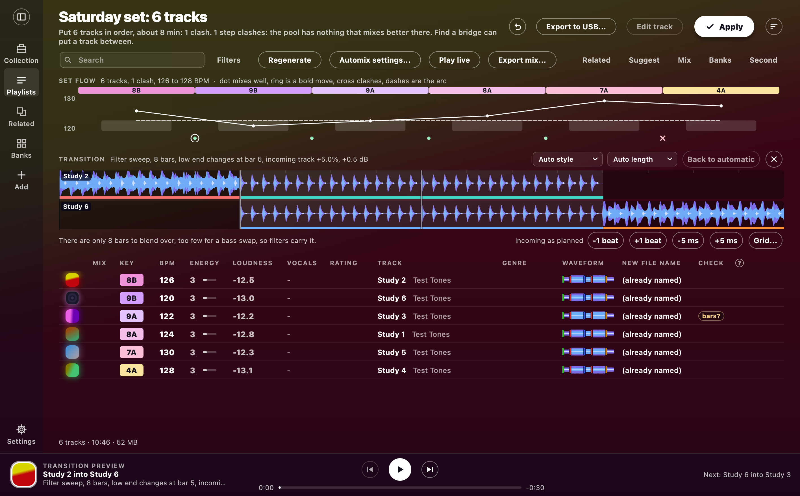

# Transition preview

**Preview transition** renders a step and plays it, so you can hear the mix before you play it out.
Press **Preview transition** over the table, press Space on a step's mark, or right-click the mark.
The preview opens under the set flow, or in its place in a short window.
It follows along as you walk the steps with Left and Right.
For any two tracks, with no playlist, [Mix with](library.md#mix-with) in the panel beside the table reads the same plan in words and plays it through this preview.

## Where the mix goes

Mixes stay on phrase lines, so a track never comes in on bar 6 of 8.
A phrase line is a phrase the analysis found, or a line every 8 bars counted on from one.
Phrase lines are never counted back from the end.

- The outgoing track leaves from its Outro or from the quiet [sections](analysis.md#phrases) before it, never mid-Drop, Chorus or Groove.
  The incoming track comes in before its first Drop, Chorus or Groove.
- A blend runs whole phrases: the longest of 8, 16 or 32 bars that fits.
  An outro a few bars short of 8 can run out under the blend.
- **Avoid vocal over vocal** shortens the blend or makes the outgoing track leave later, to keep the voices apart.
  When it can't, it holds the incoming vocal out of the blend using [stems](stems.md).
  Without stems, it tells you it can't.
- If nothing lines up, the next best option goes, and the notes say so.
  Anything you set goes the way you set it.

The incoming track takes on the outgoing track's tempo, worked out from the two beat grids.
Those can be your grids from the editor or rekordbox too, and half and double time count as one.
The incoming track also takes on the outgoing track's loudness, by up to 6 dB.
Automix listens to both kicks and nudges the mix-in until they meet, so they don't flam.

## The style

Each pair gets a style from its keys, tempos, [sections](analysis.md#phrases), energy and voices.
The note under the lanes says why.
Automix goes down this table, and the first style that fits wins:

| Style | When | What you hear |
| --- | --- | --- |
| **Echo-out** | Tempos over 8% apart, keys clash, the tempo moves inside the blend, or a track is `bars?` | The outgoing track stops on a phrase line with a two-bar tail. The next track drops in, with no stretch past 8%. |
| **Double drop** | Both build to a Drop, keys mix (no `key?`), stretch 5% or less, energy within one, no voice on both | The incoming track starts 8 or 16 bars early so the drops land together. The lows swap on the drop, and the outgoing track takes as long again to cross out. |
| **Bass swap** | Stretch 5% or less, blend 16 bars or more | Mids and highs cross over the whole blend. |
| **Filter sweep** | A bigger stretch or a short blend | The outgoing track thins out as the incoming one opens up. |
| **Echo-out** | A `key?` track, and a voice in the first half of the blend's incoming part, where a clash shows first | As above. |
| **Loop out** | The outgoing track has no room left (it ends on its Drop, say), and the incoming one has room | The outgoing track's last bar loops for 8 bars and washes out in reverb. |
| **Hard cut** | Neither track has room | The outgoing track stops on its phrase line, and the next track comes in on the next beat. |
| **Vocal over** | Only to fix two clashing voices, or an outgoing track with no quiet phrase left | One track's vocal rides the other's instrumental for 8 or 16 bars ([stems](stems.md)). |
| **Hats carry** | In place of a bass swap or filter sweep, when the incoming track has no steady kick in the blend and the outgoing one has ([stems](stems.md)) | The outgoing kick and bass go halfway. Its hats carry the groove to the end, and the new drums come in on the phrase, so two sets of hats never meet. |
| **Drum swap** | The other way round: the outgoing track has no steady kick there and the incoming one has ([stems](stems.md)) | The drums and bass swap halfway, and the music crosses over the whole blend. Two drum parts never play together, and nothing is filtered. |
| **Melodic layer** | Both keys the same and sure, and a blend of 16 bars or more ([stems](stems.md)) | The incoming melody rises under the outgoing track over the first half. The drums and bass swap, the outgoing music goes over the second half, and the incoming vocal waits for the end. |
| **Stems bass swap** | Wherever a bass swap would go ([stems](stems.md)) | The basslines swap whole at halfway, harmonics and all. An EQ bass swap lets their upper half cross over the whole blend. |

The stems styles need all of these:

- Both keys are sure, and a safe move apart.
- Neither track is `bars?`.
- The stretch is 5% or less.
- The stems measure clean there: a track's music without its own drums must hold no kick, or it would flam with the other track's kick.

In any blend where two voices would meet, and **Avoid vocal over vocal** is on, the incoming vocal waits for the end of the blend, using stems.
The note says when that happens.

When two tracks' beats sit a beat apart, it's a train-wreck, worse than no beat at all.
So every style but echo-out needs both grids to hold.
The lows always swap in half a beat, so two basslines never boom together.
The tracks cross at equal power, so two loud masters don't hammer the limiter.
Only one pair has been judged by ear so far.
So treat the style as a guess, and overrule it when your ears disagree.

## Changing it

Both tracks share one timeline at the speed they play, so the beats line up.
Whatever won't be heard is dimmed.
On the lanes, colored bands are [phrases](analysis.md#phrases) and yellow is a voice.
White marks the mix point, red marks the bass swap, and the pale band is the blend.

- Slide a track to move its mix point.
  It snaps to phrase lines, to bars with Shift, and to beats with Alt.
  The outgoing track holds still.
  The incoming track can slide past the mix point to come in later, and it stays silent until then.
- Or Tab to the lanes and pick a track with Up and Down.
  Move it with Left and Right, by bars, or by beats with Shift.
- Click to move the playhead.
  Space or Play on the [player bar](window.md#the-player-bar) plays and pauses, and Esc closes the preview.
- **Auto style** and **Auto length** choose for you.
  **Back to automatic** forgets your changes.
  A style you pick sticks as best it can.
  For example, a double drop with no drops runs as a bass swap, and says so.
  A loop-out can run 16 or 32 bars.

**Fine adjustment** fixes a grid that's a little off.
It has **-1 beat** and **+1 beat**, and **-5 ms** and **+5 ms**.
In the lanes, Alt with Left and Right does the same, and adding Shift moves 1 ms.
A readout shows how far that is from the plan.
**Grid...** fixes the chosen track's own grid, like the [track editor](editor.md#track-editor) does.
It moves bar 1 a beat either way, or the whole grid 5 ms.
Every mix with that track gets the fix, and so does rekordbox.
**Open in the track editor** goes further.

Your changes stick for that pair, in that order.
They last through restarts, Regenerate, renames and reorders.
If you change a transition while it plays, it restarts.

## When a tempo moves

A blend only needs a steady beat where it runs, so drift anywhere else costs nothing.
Drift inside the blend means an echo-out.
A track with no grid but with phrases still mixes wherever a grid through those phrases holds.

## What it won't do

A track with no grid and no phrases can't be mixed.
Automix tells you why, and plays nothing until you set a grid in the [editor](editor.md#track-editor).
The notes flag unsure keys and tempos, and stretches big enough to hear.
The bundled ffmpeg stretches with [Rubber Band](https://breakfastquay.com/rubberband/), which takes a second or so.
If you run from source without Rubber Band, Automix falls back to `atempo` and says so.
That fallback is plainer on drums.
