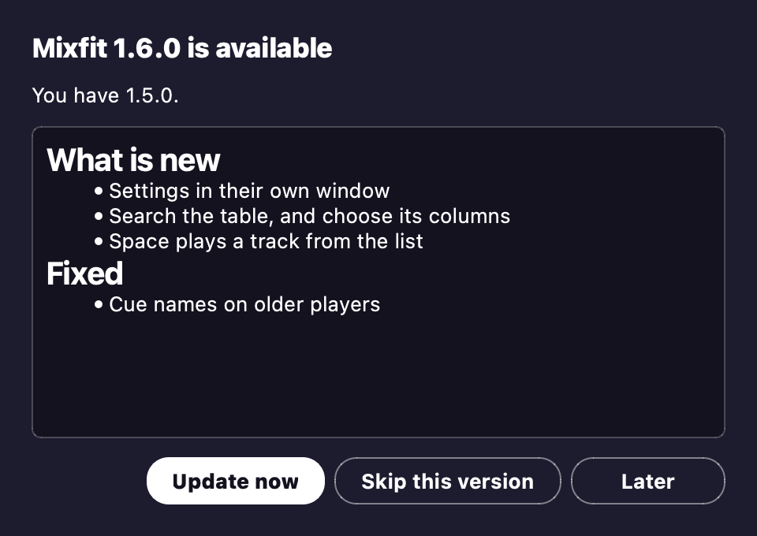

# Updates

The packaged app keeps itself up to date, so you don't have to go hunting for new versions.

## Checking

Each time the app opens, it quietly looks for a new release.
If you're offline, it just stays quiet.
**Help > Check for updates** looks for a release whenever you like.
**Check for updates at launch** turns that quiet look at startup on or off.
On a Mac, you'll find both of these in the app menu.

## Updating

When there's a new release, you see its notes, and the choice is yours:

- **Update now** downloads the release, with a progress bar and Cancel.
  Then it checks the download's SHA-256 checksum, swaps the new version in and restarts.
- **Later** asks again at the next launch.
- **Skip this version** waits for the release after it.

The update waits for a running analysis or Apply to finish.
A restart empties the table.
So if the table holds tracks you haven't applied, the app asks you first.

## What keeps it safe

- The app refuses a download with a wrong or missing checksum.
- If the app can't write to its own folder, it tells you and offers the release page instead.
- The old copy stays until the new one has started.
  If the new one doesn't start, the old one comes back, and you get a note at the next launch.
- Releases aren't code-signed.
  So the checksum proves the download arrived intact, but not who made it.

## Where releases come from

Releases come from the public [`plep7/mixfit`](https://github.com/plep7/mixfit) repository.
The app reads that repository without signing in.
