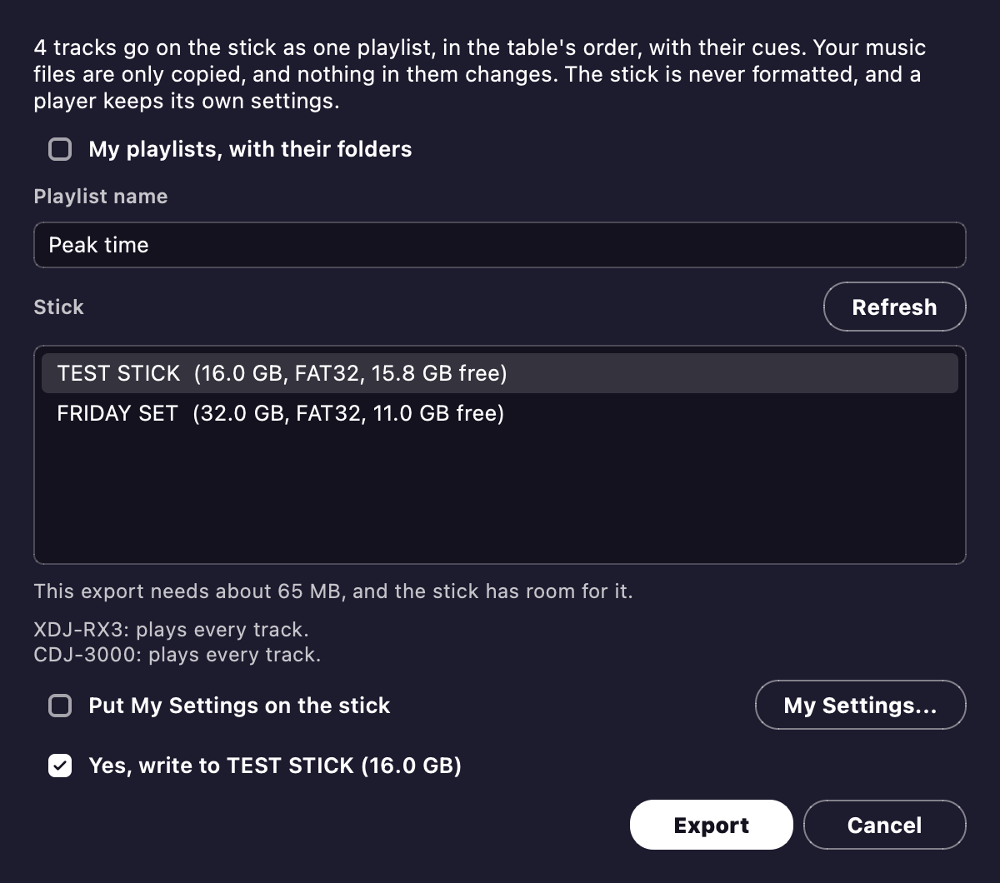

# USB and players

Export to USB writes a stick that CDJ and XDJ players can read, without going through rekordbox.
You can put My Settings on the stick too, so the player loads your setup.



## Export to USB

The **Export to USB...** button sits next to Apply.
It copies the table's tracks to a stick, with their waveforms and cues.
This feature is new, and no real player has read one of these sticks yet.
So use a spare stick, and run through the [test kit](../usb-test-kit/README.md).

- The tracks go on as one playlist, in the table's order.
  The playlist takes the name of whichever playlist is showing.
  To put your whole playlist tree on instead, pick **My playlists, with their folders**.
  Then you can browse the tree on the player.
- An Automix set gets a memory cue at each mix that [Export mix](automix.md#export-mix) plans.
- The stick gets the cues you chose under *Make rekordbox cues* ([Cue points](editor.md#cue-points)).
  These include memory cues, loops and bar cues.
  Each track's [Hot Cue Auto Load](editor.md#hot-cue-auto-load) flag goes on too.
  A track that's in your rekordbox collection keeps its own cues and grid.
- Keys show in your Key format.
- Your [My Tags](library.md#rating-color-track-info-and-my-tag) go on under their columns, so a player's My Tag filter can list them.
  They're in each track's comment as text too.
  No real player has shown these tags yet.
  A stick tells tags apart by name, so a name that's in two columns goes on in the first one only, and the dialog says so.
- Missing tracks and unanalysed tracks are left off, and the dialog tells you how many.
- You don't need to Apply first.
  But tags you haven't written to your files won't be on the stick.

### Your stick is safe

- Nothing starts ticked, even when only one stick is plugged in.
  You tick the line with the stick's name and size yourself.
- The dialog only offers removable drives, and it never formats anything.
- Mixfit refuses a stick that holds a rekordbox library.
  It also refuses a stick with any `PIONEER` or `Contents` folder that Mixfit didn't write.
  That way the library on the stick stays whole.
- You can write to a Mixfit stick again and keep the music on it.
  If rekordbox or a player has changed the stick's library since, you decide whether to erase it.
- Your music is only copied, never changed.
- The file `Mixfit build.txt` on the stick names the build that wrote it, which is handy for a test report.

### What each player plays

The dialog gives each player a line saying what that player won't play.
These limits come from each player's manual:

| | MP3 | AAC (M4A) | WAV, AIFF | FLAC | Apple Lossless |
| --- | --- | --- | --- | --- | --- |
| XDJ-RX3 | 32, 44.1, 48 kHz | 44.1, 48 kHz | 44.1, 48 kHz | 44.1, 48 kHz | No |
| CDJ-3000 | 44.1, 48 kHz | 44.1, 48 kHz | 44.1 to 96 kHz | 44.1 to 96 kHz | 44.1 to 96 kHz |

- Lossless files have to be 16 or 24 bit.
- A track that one of the players can't play still goes on, with a warning.
- Ogg, Opus and WMA files stay off the stick, because a player can hang on one.
  So do files that aren't what their name says.
  The dialog names each file it leaves off.
- Format the stick as FAT32 on a Master Boot Record.
  exFAT and GPT get a warning.
  NTFS, APFS and other formats are refused.
- The CDJ-3000X, XDJ-AZ, OPUS-QUAD and OMNIS-DUO need a OneLibrary, so they won't read the stick.

The waveforms look a little different from rekordbox's.
Tracks with a beat grid also get their [Phrases](analysis.md#phrases).
No real player has shown these phrases yet, and a track plays the same without them.
A track with no beat grid still plays, but quantize and beat sync can't use it.

### On the command line

```bash
python -m app.cli --list-usb                                          # the drives
python -m app.cli "D:/Music/Set" --export-usb E: --playlist "Friday"  # asks you to type the stick's name
python -m app.cli "D:/Music/Set" --export-usb E: --dry-run            # what it would do, or why it refuses
```

In a script, `--confirm-stick NAME` gives the stick's name up front, so nobody has to type it.
The stick format comes from the bundled [baken](https://github.com/M-Igashi/baken).
If you run from source, fetch baken once with `python -m app.usb.usb_export --fetch-baken`.

## My Settings

Tick **Put My Settings on the stick** to bring your player and mixer setup along.
The box stays off until you tick it, so by default a player keeps its own settings.
In **My Settings...** you set each setting under the name rekordbox uses, and Mixfit remembers your choices.
The `--my-settings` option does the same from the command line.

- The settings start at rekordbox's defaults, with one exception.
  Hot cue auto load starts at By track, so a track where you [turned it off](editor.md#hot-cue-auto-load) stays off.
- If you untick the box, the next export removes only the settings files that Mixfit put on the stick.
  It never removes a file that a player saved.
- No DJ profile (`djprofile.nxs`) goes on the stick.
- No real player has loaded these settings yet.

## Cues back from a stick

**Tracks > Read cues back from a stick...** picks up the changes a player made to hot cues and memory cues on a Mixfit stick.
It finds cues the player set, moved or deleted.
Choose the stick's folder, and you'll see each track's changes, like `Hot cue B moved 1:02 to 1:04`.
Nothing comes in until you press **Take**.

- Tracks with no cues of your own start ticked.
- Tracks whose cues you set, in the editor or by an import, start unticked, because the stick's cues would replace yours.
- You can't tick a track that's locked in the editor.
- The cues you take become a new version in the [track editor](editor.md#keeping-it).
  That version is labelled `Cues from` and the stick's name, so you can undo it in History.
- The grid, the phrases, the stick and your music files stay as they are.
- A moved cue keeps your name and color.
  A new cue gets the player's color.

Reading cues back only works on sticks written by this version of Mixfit or a later one.
It never works on a stick that rekordbox wrote.
This feature is new, and nobody has yet read back a stick that a real player changed.
If Mixfit finds no changes, it tells you.
A player's play history comes in through [Import playlists...](library.md#importing-from-rekordbox-apple-music-playlist-files-and-a-players-history).
