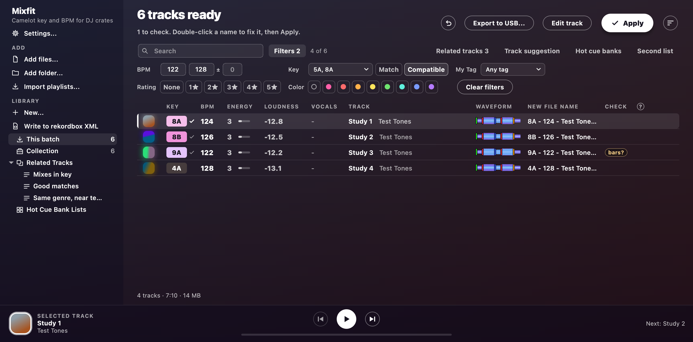
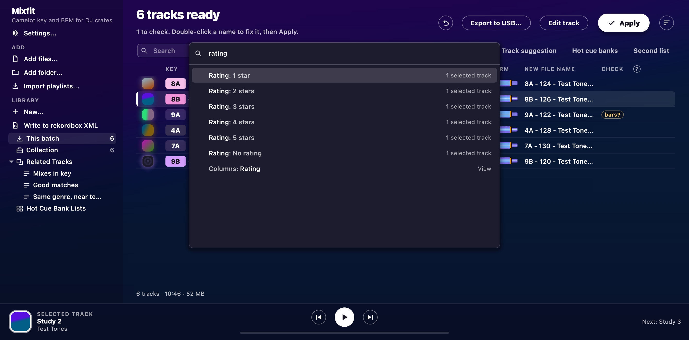

# The window

This page covers the track table, search, filters, sorting, the player bar, the keys and the command palette.
[Settings](settings.md) gets its own page, and so does the [library](library.md) in the sidebar.

## Layout

The sidebar holds the ways to add tracks, your favourites and the library.
**Settings** sits at the top of the sidebar, and you can also open it from the Edit menu (the app menu on a Mac).
The top right of the window has **Apply**, **Undo last Apply** (the round arrow), **Export to USB...** and [Activity](library.md#activity).
You'll find Export CSV and Clear the batch in the Tracks menu.
While the editor is open, Edit > Undo and Redo take back the editor's last change.
Otherwise they take back the last Apply.

## Notifications

What Apply, Undo, Export to USB, a sync and an import did shows as a note in the bottom right corner, above the player.
After Apply the note has an **Undo** button that puts the batch back at once, with no question.
A note stays for a few seconds, and waits while the pointer is over it, a button in it has focus, or the window is hidden.
Three show at once, and the oldest goes when a fourth comes.
A failure stays until you dismiss it, and the warning box that goes with an Apply failure still opens.
Press Ctrl or Cmd + Shift + J (or choose View > Notifications) to move focus to the newest note: Tab steps through the others, Space presses the focused button, and Esc dismisses the note and puts focus back where it was.
A screen reader reads each note as it arrives.

Behind everything, the window shows the selected track's cover, blurred.
While a track is analysing, it shows that track's cover instead.
[Background](settings.md#background) changes that.
Each key shows as a chip in the color Mixed In Key uses for that key.

While a drop is analysing, the card shows the track and a bar.
Until the first track is in, the bar sweeps and the card counts the seconds so far, so a long first track doesn't look stuck.
After that it shows the count and the time left.
The heading and the sidebar counts roll to their new number when you add tracks or change a filter, and they stay still when you ask for less motion.

There's no system title bar.
To move the window, drag the header or the top of the sidebar.
On a Mac, the traffic lights sit over the sidebar's corner.
Double-clicking there does whatever System Settings > Desktop & Dock says.
On Windows, the menus share the top row with Minimize, Maximize and Close.
Double-click the empty part of that row to maximize or restore the window, and right-click it for the window menu.
Snap layouts, Aero Snap, Win+arrow keys and Alt+Space work as usual.

Buttons answer your pointer with a short change: a soft fill when you hover and, on the larger buttons, a small press when you click.
Keys never animate: pressing Space or Return on a button just does it.
The side panel fades in, and the track editor is there the moment you open it.
Every click does its work at once, and the motion only shows it.
Every page and panel you open has a way back in plain sight: the back arrow in the editor, the close button on the panel, and Esc.
If your system asks for less motion (Reduce Motion on a Mac, Animation effects off on Windows), none of this moves and every change just appears, and the spinner on a track being analysed stays still and fades gently in and out instead of turning.

## The table

Each row shows the cover, key, BPM, energy, loudness, vocals, title and artist, waveform, new file name and checks.
[Analysis](analysis.md) explains what each one means.

- **Rows:** View > Rows lets you pick compact or comfortable rows.
  Compact rows take one line.
  Comfortable rows take two lines, with the artist under the title and the old file name under the new one.
- **Harmonic match:** keys that mix with the track playing, or with the selected one, keep their color, and the rest dim.
  A bold tick marks the same key, and a fine tick marks a key one step away.
  View > Harmonic match picks Strict, Fuzzy or Off.
  For 8A, Strict matches 7A, 9A and 8B, and Fuzzy adds 7B and 9B.
- **Columns:** to show or hide a column, right-click the header or go to View > Columns.
  Artist, Comment and Plays start hidden, because the title already shows the artist and the comment mostly repeats the key.
  Drag a heading to reorder the columns, and drag a separator to resize one.
  Double-click a separator to fit the column to its contents.
  The app remembers your layout for next time, and **Reset columns** brings back the default.
  In a narrow window, or with the panel open, some columns step aside so the title keeps its room.
  They go in this order: Vocals, Loudness, Energy, Waveform and New file name.
- **Editing:** double-click the artist (or *Add artist*) to edit it.
  F2 (Return on macOS) edits the title.
- **Search:** type some words, and the table shows only the tracks that have all of them.
  The search looks in the title, artist, file name, key (in either notation), BPM, genre, label, comment and My Tags.
  Esc clears the search.
  If no track matches, the table says so and offers **Clear search**, and **Clear filters** when a filter is on.
  The heading then counts the tracks that show, as `5 of 7 tracks ready`.

### The filter bar

To open the filter bar, hit **Filters** beside the search, press Ctrl or Cmd + Shift + F, or choose View > Filter bar.
A track shows when it passes the search and every filter that's on.

| Filter | What it does |
| --- | --- |
| BPM | Fill both boxes for a range, or fill one for just that tempo. The ± box widens the range by up to 15 BPM at each end. Half and double time count, so 87 passes a range of 170 to 178. |
| Key | Pick keys from the wheel. **Match** shows just those keys. **Compatible** also adds each key's relative key and the keys one step either way round the wheel. |
| Rating | Pick any number of ratings, or **None** for unrated tracks. |
| Color | Pick any number of colors, or the ring for tracks with no color. |
| My Tag | Tick tags, or **No tag**. Then pick whether a track needs any of the tags or all of them. |

The line beside the search counts the tracks that are left, and the tab counts the filters that are on.
Filters stay on when you hide the bar or change the view, until you press **Clear filters**.
A track that stops passing the filters drops out straight away.
So if you filter for None under Rating and rate as you go, you walk down your pile of unrated tracks without getting lost in music.
Tracks that are still analysing stay in the table until they have a result.

You can't reach hidden tracks.
Select All and Shift-selecting skip them.
**Apply**, **Export to USB**, **Export CSV**, **Smart Fixes** and a sync with no playlists only work on the tracks that show.
If you jump to a hidden track from Related tracks or a bank, the search and filters clear.

### Sorting

Click a heading to sort by that column, and click it again to reverse the order.
Shift-click more headings to break ties (Key, then BPM, say).
Each of those headings shows its place in the order next to its arrow.
Shift-click a heading again to reverse it, and once more to drop it.
A plain click takes you back to sorting by one column.
View > Sort by and Then sort by do the same from the keyboard.

Keys sort round the circle of fifths, so keys that mix sit together: 1A, 1B, 2A, or C, Am, G, Em.
Tracks with no key stay last in either direction.

### Jumping to a track

With the table in focus, type the start of a name to jump to that track, like rekordbox's Alphabet Search.
The jump looks in the column you sorted by, so `9b` jumps within Key and `128` jumps within BPM.
When nothing is sorted, it looks in the title.
Case and accents don't matter.
If you pause for a second, the next letter you type starts a new name.
Backspace takes back a letter.
Backspace only removes a track when there are no letters left to take back.
Space and E carry on a name while a row still matches it.
Otherwise Space plays and E opens the editor, as usual.
Because plain E opens the editor, use Shift+E to jump to a name that starts with E.

### What a row's marks mean

A clock on the cover means the track is waiting for analysis, and a spinner means it's analysing.
Before the checks, a row can show three marks:

- A padlock means the track is locked.
- A pencil means its grid or cues were edited.
- A flag means it has cues meant for it: yours, from rekordbox, imported, or made by Apply.

Cues that the analysis only suggests show on the waveform instead.
The marks always keep that order, so sorting by Check groups tracks by their marks.
To read a row's marks, hover over them or arrow to the cell.
The `?` beside the Check heading lists every mark.
A missing file shows a `missing` check.

### The footer

The line under the table tells you how many tracks are showing, how long they run and how much space they take.
If you select two or more tracks, the line counts just those: `3 of 128 tracks selected · 14:20 · 31 MB`.
The line leaves out tracks that are still analysing or missing, and it says how many it left out.
For a track over the analysis limit, the line only counts the part that was analysed.

### Listening from the list

Press Space, or click a cover, to play the track, and do it again to pause.
Click the waveform to play from that spot.
Opening the editor, Apply or Undo last Apply stops the sound.

## The player bar

Everything plays from one bar along the bottom of the window.
That covers a track from the list, the [editor](editor.md#track-editor), a [transition](automix.md#transition-preview) and the [live set](automix.md#play-live).
Previous, Play and Next sit over a progress bar that shows the time gone and the time left.
The left side of the player bar tells you what's playing (`TRACK`, `TRACK EDITOR`, `TRANSITION PREVIEW` or `LIVE SET`).
The right side tells you what Next goes to.

- **A track from the list:** Previous and Next go up and down the table, and keep playing if the track was playing.
- **The editor:** Previous and Next open the track above or below, and keep playing if the track was playing.
- **A transition:** Play renders the transition and plays it, and Previous and Next walk through the set.
- **The live set:** Play pauses, Next skips, and **Stop** ends the set.
  Previous does nothing, because a live set only goes forward.

The player bar picks what to control in this order:

1. The editor, while it's open.
2. Whatever is sounding.
3. The live set.
4. An open transition.
5. The list.

So once a track from the list pauses, the player bar goes back to the live set or the transition.

Click or drag the progress bar to jump, and a paused track stays paused.
You can also Tab to the progress bar and use Left and Right to move 10 seconds.
Space plays and pauses from anywhere you're not typing.
Media keys (play, pause, next, previous and stop) work too.
On Windows, they work while the window is in front.
On a Mac, they work through Now Playing, even from another app.
Sound goes to your [Audio output](settings.md#audio-output).

## Keys

You can do everything from the keyboard and with a screen reader.
The screen reader also hears when analysis starts and ends, and what Apply did.
Tab goes through the window from the sidebar to the player bar, and a box round a list, table or text box shows where you are.
Tab onto an icon button shows what it does, and Esc hides that.
A window opens on the first thing you would type in.

| Key | Does |
| --- | --- |
| Tab | Move between controls |
| Arrow keys | Move through the table |
| F2 (Return on macOS) | Edit the title |
| Space | Play or pause |
| Esc | Stop |
| Delete | Remove the selected rows |
| E, Return on Windows, Cmd+Down on macOS | Open the [track editor](editor.md#track-editor) (or double-click a waveform or cover) |
| Ctrl or Cmd + F | Search |
| Ctrl or Cmd + Shift + F | The filter bar |
| Ctrl or Cmd + I | Track info |
| Ctrl or Cmd + comma | Settings |
| Ctrl or Cmd + N | New playlist |
| Ctrl or Cmd + J | Activity |
| Ctrl or Cmd + Shift + J | [Notifications](#notifications) |
| Ctrl or Cmd + L | Select the track playing (in the Collection if the table doesn't hold it) |
| Shift + Cmd + R (Shift + Ctrl + R on Windows) | Show the file in Finder or File Explorer |
| Cmd+K on a Mac, Ctrl+K on Windows, or Ctrl or Cmd + Shift + P | The command palette |

If you drop a file the window can't read, the window leaves it out.
If no files are left, the status line says so.

## Command palette

Press Cmd+K (Ctrl+K on Windows) or choose Edit > Command palette....
Then type a few letters and hit Enter.
The palette offers whatever can run right now.
That includes menus, buttons, the editor's tools while the editor is open, and right-click actions on the selected tracks.
It also includes every setting and every place in the library.
For example, `rating 4` rates the selected tracks, and `add deep` adds them to a playlist with Deep in its name.
`hcal` finds Hot Cue Auto Load by its initials.
Words match in any order, and case and accents don't matter.
Other apps' names work too, like *crate* for a playlist or *intelligent* for a matchlist.
Arrows or Tab move through the list, Enter runs the action, and Esc closes the palette.
With nothing typed, the palette lists what you used last, then the actions, then the library.
