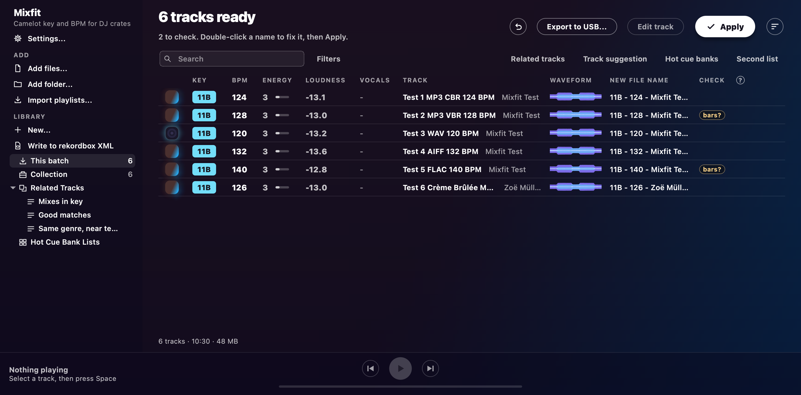
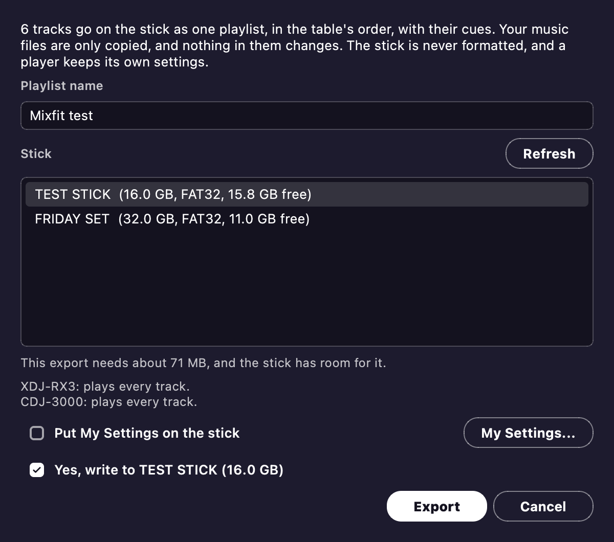
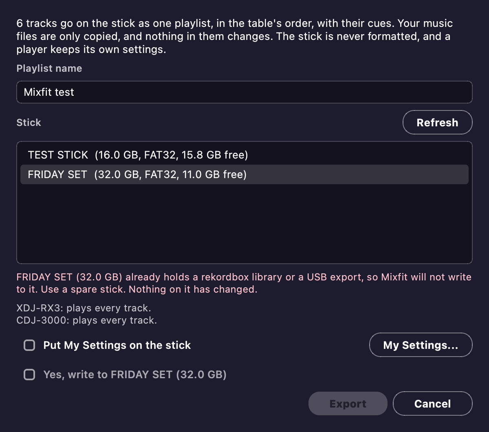

# USB stick test kit

This kit finds out whether real DJ players are happy with a stick made by Mixfit.
No real player has read one yet, so the first test is the one that counts.

The kit has two parts.
This page is for the person making the sticks.
[The stick test](stick-test.md) is the page you send a friend, and it works as it is.

Your friends never need Mixfit.
You make each stick and hand it over.



## What you need

- One spare USB stick per friend, 32 GB or smaller, formatted as FAT32 on a Master Boot Record.
  Both players read that.
  On a Mac, Disk Utility calls it MS-DOS (FAT) with Master Boot Record.
- A build of Mixfit.
- If you run Mixfit from source, fetch the export tool once: `python -m app.usb.usb_export --fetch-baken`.

Use a spare stick.
Mixfit refuses a stick with a rekordbox library on it.
It never formats anything either, so formatting the stick is up to you.

## Make the six test tracks

```bash
python tests/make_test_tracks.py ~/Desktop/MixfitTest
```

This makes six tracks of about two minutes each, so nothing on the stick is copyrighted or personal.
Each one has obvious changes where its cues should land, and its tempo is in its title.

| Track | Format | What it checks |
| --- | --- | --- |
| 1 | MP3, 320 kbps | Baseline, and encoder delay |
| 2 | MP3, variable bit rate | Seek accuracy |
| 3 | WAV | Baseline with no delay |
| 4 | AIFF | Baseline with no delay |
| 5 | FLAC | Seeking without a seek table |
| 6 | M4A (AAC), accented artist and title | Encoder delay, accented names |

All six are 44.1 kHz.

## Write the stick

1. Plug the stick in, and open Mixfit.
2. Drop the `MixfitTest` folder on the window, and wait for the analysis to finish.
3. Press **Export to USB...** beside **Apply**, and type `Mixfit test` as the playlist name.
4. Click your stick in the list.
   Mixfit never chooses one for you, even when only one is plugged in.

   

5. Check the name and size, tick **Yes, write to** that stick, and press **Export**.
6. Wait for it to finish.
   Then eject the stick before you pull it out.

If a stick gets refused, the dialog says why, and nothing on the stick has changed.



The command line does the same job:

```bash
python -m app.cli --list-usb
python -m app.cli ~/Desktop/MixfitTest --export-usb /Volumes/STICK --playlist "Mixfit test"
```

Don't check a stick by opening it in rekordbox.
rekordbox rewrites a library it opens, and that spoils the test.

To see which build a stick came from, read `Mixfit build.txt` at its root.

## Before you send a stick

Make sure the build has beat grids.
Without them, Mixfit warns that tracks have no beat grid when the export ends.
Steps 5 and 10 of the stick test can't work then.

`Mixfit build.txt` should also say `Phrases: 6`.
Otherwise step 13 has nothing to show.
On each test track the phrases run Intro, Groove, Build, Drop and Outro, and they change where pads B to E land.
On a player they show as rekordbox's Intro, Chorus, Up, Chorus and Outro.

## After a round

A freeze, a blank field or a wrong position is a bug.
File it with the photos, and with the build from `Mixfit build.txt`.
Send a new stick once it's fixed.

Before you erase the stick, choose **Tracks > Read cues back from a stick...** in Mixfit and pick it.
It should list track 2 with hot cue H set and a memory cue stored, from step 14.
If it finds no change, keep the stick as it is and file that, because it shows where the player keeps its cues.

A clean result is news for [baken](https://github.com/M-Igashi/baken) too, because nobody has reported an XDJ-RX3 there yet.
So it's worth sharing, with your friend's OK.

Going back is simple, because nothing permanent happens.
Your friend goes back to their usual stick, and the test stick can be erased.
